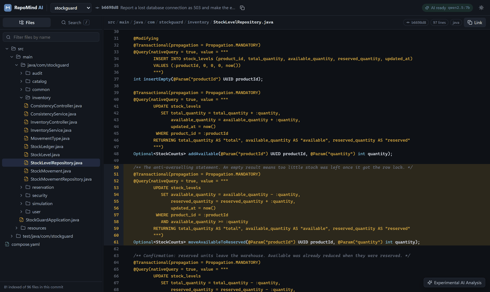
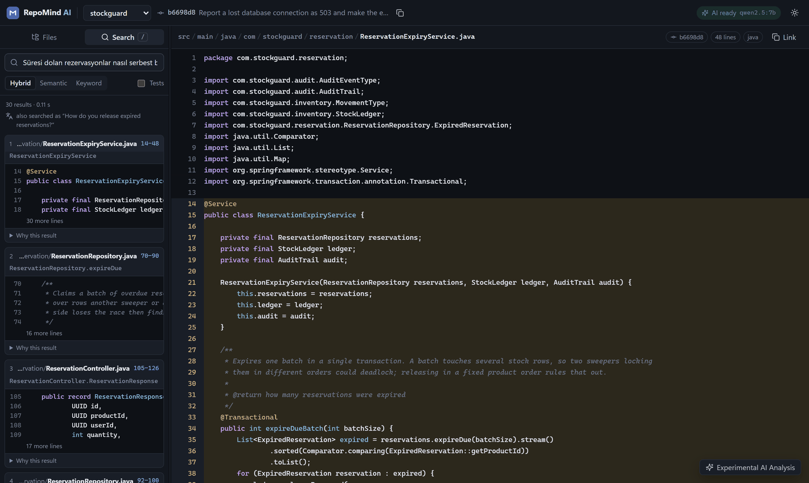
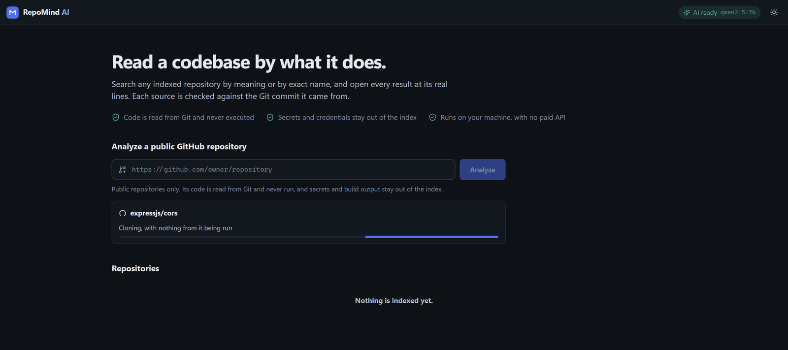
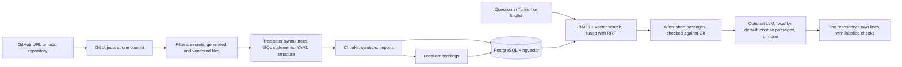
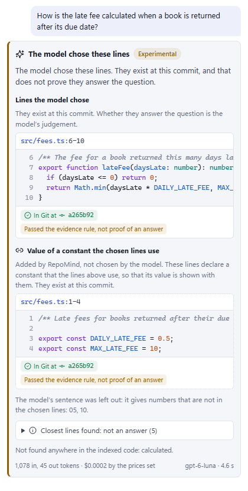
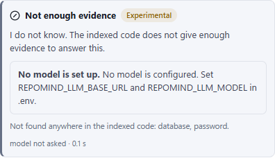
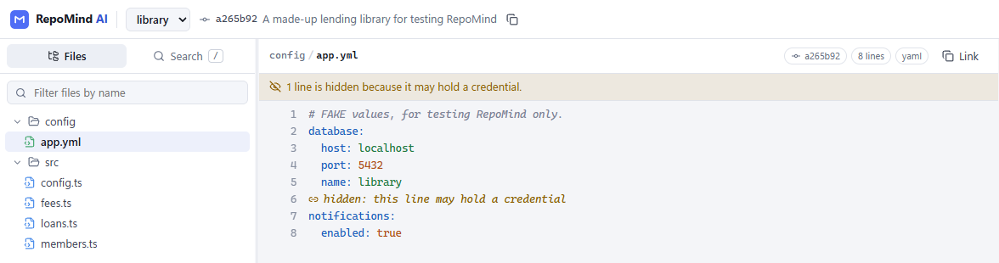

[🇹🇷 Türkçe](README.md) | [🇬🇧 English](README.en.md)

# RepoMind AI

**Find where and how something is done in a codebase, and read the exact lines that do it.**

RepoMind indexes a GitHub repository locally and lets you browse, search and question it in Turkish or English. Every result is a real range of lines, pinned to the Git commit it came from, so you can open it, link to it and check it yourself. It runs on your own machine. The default setup needs no account, no API key and no paid API. The OpenAI API is an option, and it costs money.

> **Status: a working local web application for one person on one machine.** Searching and reading code are dependable. **The AI analysis is experimental and often wrong:** in the last measurement, with `qwen2.5:7b`, it gave a fully right source for 13 of 32 questions, and a wrong one for 6. Read every line it points at. See [AI accuracy](#ai-accuracy).



## Contents

- [Why](#why) · [Features](#features) · [Screenshots](#screenshots) · [How it works](#how-it-works)
- [Getting started on Windows](#getting-started-on-windows): [your first repository](#your-first-repository), [AI analysis](#ai-analysis-optional), [with or without a GPU](#with-or-without-a-gpu), [common problems](#common-problems)
- [Using it](#using-it) · [MCP server](#mcp-server) · [AI accuracy](#ai-accuracy) · [Security](#security) · [Tests](#tests)
- [Project structure](#project-structure) · [Known limitations](#known-limitations) · [Third-party software and models](#third-party-software-and-models) · [License](#license)

## Why

Asking a chat model about an unfamiliar repository tends to produce confident answers that name files, functions and settings that do not exist. RepoMind turns this around: it searches first, and every answer is made of the repository's own lines. Each line is checked against Git, and a model, when one is used, only chooses among lines that were found. It never writes code or facts of its own into the answer. When the evidence is too thin, it says "I do not know".

## Features

- **Add a public GitHub repository by URL.** It is cloned safely, parsed and indexed in the background, with progress, readable errors and a retry.
- **Browse the code as committed.** A file tree and a code view with line numbers and syntax highlighting, read from Git at the indexed commit. Links such as `…/blob/<commit>/src/App.ts#L12-L20` always open the same lines, and for a repository added from GitHub, a button opens them there too.
- **Search code three ways.** Keyword (BM25), semantic (vector search with pgvector), or hybrid, which fuses both with Reciprocal Rank Fusion. Each result shows why it was found and opens at its lines.
- **Ask in Turkish or English.** Turkish questions are translated locally, and both wordings are searched. Code, identifiers and config keys stay unchanged.
- **Experimental AI analysis.** By default a local model, `qwen2.5:7b` on Ollama, chooses among the lines found, or declines. The OpenAI API can be used instead: it costs money, and has to be switched on. Lines that exist in Git, lines that passed the evidence rule, and the model's own sentence are shown as separate, labelled things.
- **An MCP server.** An MCP client such as Claude Code can search the listed repositories and read lines from Git at their indexed commit, through a local stdio server with three read-only tools: `list_repositories`, `search_code` and `get_verified_source`. It asks no model.
- **Local and private by default.** It listens only on `127.0.0.1`, embeddings run on the CPU, and a GPU is optional.
- **Treats repositories as hostile.** Code is never executed, secrets and credentials stay out of the index, prompt injection in code is contained, and everything is rendered as text.

Java, TypeScript (including TSX), JavaScript, SQL and YAML are indexed. Other files appear in counts but are not searched.

## Screenshots

Taken from the running application, on [StockGuard](https://github.com/melihuur1/stockguard) and the public [`expressjs/cors`](https://github.com/expressjs/cors). Nothing in them was edited.

**Hybrid search, asked in Turkish.** The question is also searched as its English translation, shown under the result count, and the first result is open at its lines.



**Adding a public GitHub repository.** The page follows each step while the repository is cloned, with nothing from it run, and then parsed and embedded.



The code view at the top of this page shows a Java file at the indexed commit, opened from a link that selects lines 50 to 61.

## How it works



1. **Read** one commit from Git's object database. Analyzed repositories are never modified, checked out or executed.
2. **Parse** Java, TypeScript and JavaScript with Tree-sitter into syntax-aligned chunks, with their symbols and imports. SQL is split into statements and YAML into its structure.
3. **Exclude** hidden, generated, vendored and build files, and anything that looks like a credential.
4. **Embed** chunks locally, caching by content so unchanged code is never embedded twice.
5. **Search** with BM25 and pgvector, fused with Reciprocal Rank Fusion, and translate Turkish questions locally.
6. **Answer** by narrowing results to a few short passages with no model, then let an optional LLM choose among them. Each passage is checked against Git, and lines that share too little with the question cannot count as evidence.

| Layer | Technology |
| --- | --- |
| Backend | Python 3.11+, FastAPI, Uvicorn |
| Parsing | Tree-sitter syntax trees (AST) for Java, TypeScript, TSX and JavaScript, plus SQL statement and YAML structure chunking |
| Storage | PostgreSQL 17 with pgvector, in Docker |
| Embeddings | [`intfloat/multilingual-e5-small`](https://huggingface.co/intfloat/multilingual-e5-small), 384 dimensions, through fastembed and ONNX Runtime, on the CPU |
| Search | BM25 and cosine similarity, fused with Reciprocal Rank Fusion |
| Translation | Opus-MT Turkish to English through CTranslate2, on the CPU, and the LLM when it is running |
| LLM, optional | `qwen2.5:7b` on Ollama in Docker, the default. Any OpenAI-compatible endpoint, or the OpenAI API, which costs money |
| MCP | A local stdio server built with the MCP Python SDK 2.x, the optional extra `[mcp]` |
| Frontend | React 19, TypeScript, Vite, TanStack Query, React Router, highlight.js through lowlight |
| Tests | pytest, Vitest, Playwright in Edge or Chrome |

Design and trade-offs: [docs/architecture.md](docs/architecture.md). Measurements: [docs/evaluation.md](docs/evaluation.md).

## Getting started on Windows

| You need | Version | Notes |
| --- | --- | --- |
| Windows 10 or 11 | | Developed and tested on Windows 11. macOS and Linux should work, but are untested |
| [Python](https://www.python.org/downloads/) | 3.11 or newer | Tested with 3.13 |
| [Node.js](https://nodejs.org/) | 20 or newer | Only to build the web client. Tested with 26 |
| [Git](https://git-scm.com/download/win) | any recent | Tested with 2.51 |
| [Docker Desktop](https://www.docker.com/products/docker-desktop/) | with WSL 2 | Runs PostgreSQL, and optionally the LLM |
| Memory | see notes | The RepoMind process used 1 to 1.9 GB here, besides Docker. The 7B model needs about 6.4 GB more |
| GPU | none needed | An NVIDIA GPU can speed up the optional LLM |

In PowerShell, from the folder where you keep projects:

```powershell
git clone https://github.com/melihuur1/repomind-ai.git
cd repomind-ai

py -3 -m venv .venv
.\.venv\Scripts\python.exe -m pip install -e ".[dev]"
Copy-Item .env.example .env

docker compose up -d db              # PostgreSQL + pgvector on 127.0.0.1:55432

npm --prefix web ci
npm --prefix web run build           # builds the web client into web\dist

.\.venv\Scripts\python.exe -m repomind serve
```

Open <http://127.0.0.1:7321>. None of this needs an API key. The commands call the virtual environment's Python directly, so PowerShell's script policy does not get in the way of activating it. On macOS or Linux, use `python3 -m venv .venv`, `.venv/bin/python` and `cp .env.example .env`.

### Your first repository

Paste a public repository's address, such as `https://github.com/expressjs/cors`, into **Analyze a public GitHub repository** and press **Analyze**. The page shows each step while you keep working, then offers **Open**.

The first indexing downloads the embedding and translation models into `.models\`, about 0.6 GB, once. After that, on a laptop CPU, a small repository took about 10 seconds, and one of 59 source files and 426 chunks took 27 seconds.

To index a repository you already have on disk instead, which can be private:

```powershell
.\.venv\Scripts\python.exe -m repomind index --path "C:\path\to\repository"
```

### AI analysis, optional

Search, the file tree and the code view need no model. To let a local model choose among the lines found, which needs no account or API key:

```powershell
docker compose --profile llm up -d ollama
docker exec repomind-ollama ollama pull qwen2.5:7b      # about 4.7 GB, once
```

Then remove the `#` from these two lines in `.env`, and restart `repomind serve`:

```bash
REPOMIND_LLM_BASE_URL=http://127.0.0.1:11535/v1
REPOMIND_LLM_MODEL=qwen2.5:7b
```

The model can be started and stopped while RepoMind runs, and the status in the top bar follows it. `docker compose stop ollama` gives its memory back. The container keeps one model loaded at a time and is limited to 8 GB.

**A server of your own.** A larger model on another machine works through the same settings: see the block in `.env.example`. Each question and the lines of code chosen for it are sent to that server. It has to be switched on with `REPOMIND_LLM_ALLOW_REMOTE=1`, and the page says when one is in use.

**The OpenAI API.** Optional, and it costs money. Each question, and the lines of code chosen for it, are sent to OpenAI. Lines that may hold a credential are left out first, by rules that can miss what they do not recognise. RepoMind sends `store: false`, which asks OpenAI not to keep the exchange for its own products. It is not a promise that nothing is kept: OpenAI's own data policy decides that. In `.env`, which Git ignores:

```bash
REPOMIND_LLM_PROVIDER=openai
REPOMIND_LLM_MODEL=              # from OpenAI's model list, checked on the day
REPOMIND_LLM_API_KEY=            # never in a file Git tracks
REPOMIND_LLM_ALLOW_REMOTE=1      # consent to send code
REPOMIND_LLM_INPUT_USD_PER_MTOK=     # from OpenAI's pricing page, above 0
REPOMIND_LLM_OUTPUT_USD_PER_MTOK=    # the same
REPOMIND_LLM_CACHE_WRITE_USD_PER_MTOK=   # the 30-minute cache write price, above 0
# REPOMIND_LLM_CACHED_INPUT_USD_PER_MTOK= # optional; without it, cache reads count at the full input price
REPOMIND_LLM_MAX_TOTAL_COST_USD=0.05 # RepoMind's own count from your prices, not an exact ceiling
# REPOMIND_LLM_REASONING_EFFORT=low  # only for a reasoning model, with a value it accepts
```

- **No model or price is written in here.** Both change, so take them from [OpenAI's model list](https://platform.openai.com/docs/models) and [pricing page](https://openai.com/api/pricing/) on the day.
- **The address is fixed.** It is `https://api.openai.com/v1`, and the key is never sent anywhere else, also not after a redirect.
- **Cached input has its own prices.** OpenAI caches the start of a long prompt by itself. Each input token is billed at one of three prices: uncached, read from the cache, or written to it, and a write replaces the uncached price instead of adding to it. RepoMind counts each part at its own price. Before a request, it allows for every input token at the highest of them.
- **The budget is not an exact ceiling.** RepoMind sends nothing more once its own count, from the prices you entered, says the next request could pass the budget.
  - It can still be passed: by wrong prices, by a token estimate that is too low, or by two questions asked at the same moment.
  - The count is not OpenAI's bill.
  - Set a spending limit on the OpenAI project as well.
- **A Turkish question is two requests.** The model translates the question first, then chooses among the passages. Search on its own translates on this machine and sends nothing.
- **A setting that is wrong is named** in the top bar as **AI settings invalid**, and no request is made.
- **What the page shows.** The AI panel shows the model, the note on what is sent, and the spending RepoMind has counted from your prices, which is not OpenAI's bill. A cost counted at its most, for a request that failed after it may have been charged, is marked as such.
- **When OpenAI fails,** whether the key is refused, a limit is reached, the budget is spent or it cannot be reached, a question still returns the closest lines found by search, and says why.
- **Going back.** Remove `REPOMIND_LLM_PROVIDER` and the key, and restore the two local lines.

Before the first real request, read [docs/openai-first-run.md](docs/openai-first-run.md).

**One real OpenAI request, on a made-up repository.** It was asked once, on 2026-11-24, with `gpt-6-luna`, about a made-up lending library indexed at commit `a265b92`. The image is a crop of the answer.
- **Chosen and added.** The model chose `src/fees.ts:6-10`. RepoMind added `src/fees.ts:1-4`, which declares the constants those lines use. The model did not choose it.
- **Not proof.** Both ranges are in Git at `a265b92` and passed the evidence rule. That does not prove that they answer the question.
- **The model's note** was left out, because it gave numbers that are not in the chosen lines.
- **One question, not a measurement.** No OpenAI model has been evaluated for accuracy in RepoMind.
- **The cost shown** is RepoMind's count from the prices set, not OpenAI's bill.



### With or without a GPU

**Without a GPU** nothing changes: this is the default, and only the optional LLM is slower. On the development machine one Turkish question took about 50 seconds on the CPU, including loading the model.

**With an NVIDIA GPU**, add these two lines to `.env` and run `docker compose --profile llm up -d ollama` again. Layers that fit in the GPU's memory run there. On a 4 GB RTX 3050 the same question took about 12 seconds.

```bash
COMPOSE_PATH_SEPARATOR=,
COMPOSE_FILE=compose.yaml,compose.gpu.yaml
```

Those are single questions on one machine, not benchmarks.

### Common problems

| What you see | Why | What to do |
| --- | --- | --- |
| `Port 7321 cannot be used` | Another program holds it, or Windows reserves the range | Add `--port 7400` to `repomind serve`, or choose another free port |
| `The web client is not built` | `web\dist` does not exist yet | `npm --prefix web ci`, then `npm --prefix web run build`. No restart is needed |
| The page cannot load repositories, and `/api/health` reports `"database": false` | The database container is not running | `docker compose up -d db`, and check `docker compose ps` |
| **AI not set up** in the top bar | No model is configured in `.env` | See [AI analysis](#ai-analysis-optional) |
| **AI offline** | Ollama is not running | `docker compose --profile llm up -d ollama` |
| **AI model missing** | The model was not pulled | `docker exec repomind-ollama ollama pull qwen2.5:7b` |
| **AI paused** | Less than 4 GB of memory is free | Close something, and ask again |
| **AI settings invalid** | A model setting in `.env` is wrong, for example `REPOMIND_LLM_PROVIDER=openai` without a key or prices | The AI panel names the setting |
| **AI key refused** | OpenAI did not accept the key (HTTP 401 or 403) | Check `REPOMIND_LLM_API_KEY`, and that the key is active |
| **AI budget spent** | The next request could pass `REPOMIND_LLM_MAX_TOTAL_COST_USD` | Raise it, if more spending is intended |
| **AI limited** | OpenAI's quota, spending limit or rate limit | The AI panel says which. A rate limit passes; a quota needs the OpenAI account |
| **AI request refused** | OpenAI did not accept the request, often a parameter the model does not take | For a reasoning model, set `REPOMIND_LLM_REASONING_EFFORT` |
| `GitHub is limiting requests from this machine` | GitHub's anonymous API allows about 60 requests an hour | Wait, then press **Retry** |
| `Git on Windows cannot write a clone this deep in the folder tree` | The clone's path would pass 260 characters | Set `REPOMIND_DATA_DIR=C:\repomind-data` in `.env`, or keep the project in a short path |
| `npm warn install-scripts … esbuild` during `npm ci` | npm 11 does not run install scripts unless approved | Harmless: the build works without it |
| A Hugging Face warning about symlinks | Windows without Developer Mode | Harmless. `HF_HUB_DISABLE_SYMLINKS_WARNING=1` silences it |

## Using it

- **Repositories:** what is indexed, with commit, languages and counts. Repositories added by URL can be removed, which deletes only RepoMind's index and clone. To pick up new commits, add the same address again. The same commit is never indexed twice.
- **Files:** click line numbers to select a range, with Shift for several lines, and copy the link. **GitHub** opens the same lines there.
- **Search** (`/` focuses it): hybrid suits most questions, keyword suits exact names such as `cancelReservation` or `token-ttl`, and semantic suits descriptions. Test code is left out unless you tick **Tests** or the question mentions tests.
- **Experimental AI Analysis:** ask about the open repository in Turkish or English. What each part of a reply means:

| Shown as | What it means | What it does not mean |
| --- | --- | --- |
| **In Git at `abc1234`** | These exact lines exist in that commit. This is checked | That they answer the question |
| **The model chose these lines** | The model picked them, and they share enough words with the question to pass the evidence rule | That they are right. It is the model's judgement, and often wrong |
| **Model's reading** | One sentence from the model, collapsed and marked as unverified | That it is true. These sentences have described features that do not exist |
| **Not enough evidence** | "I do not know": no lines passed | That the code certainly lacks it. Search misses things |
| **Source to review** | The model pointed here, and the evidence rule did not accept it | An answer |
| **Closest lines found** | What search found, with no judgement from a model | An answer |
| **AI unavailable** | The model was not asked: it is off, memory is low, its key was refused, its budget is spent or a limit was reached. The lines below were found by search alone, and the reason is given | A failure: everything else keeps working |

**When the evidence is not there, the answer is "I do not know".** This is the same made-up repository, with no model configured. RepoMind was asked "What is the database password in the configuration?":
- **The answer.** "Not enough evidence", given before any model is asked.
- **Why.** The words "database" and "password" are nowhere in the indexed code, because indexing left out the part of the configuration file that holds the fake password.
- **Whose answer it is.** This is a rule in RepoMind, not a model's answer.



## MCP server

`python -m repomind.mcp_server` lets an MCP client, such as Claude Code, search RepoMind's index and read verified lines from it. It is a local server on stdio, built with the MCP Python SDK. It opens no network port and asks no model. The install command above already includes the SDK; on its own, it is the extra `[mcp]`.

| Tool | What it returns |
| --- | --- |
| `list_repositories` | The repositories it may show, with their indexed commit and index version, and whether they can be searched |
| `search_code` | RepoMind's hybrid, keyword or semantic search in one repository, up to 20 results. Each result is checked against Git at the indexed commit. One that does not match, or may hold a credential, is left out |
| `get_verified_source` | Up to 200 lines of one indexed file, read from Git at the indexed commit, with credential lines hidden |

**Before you connect it:**
- **A repository indexed by this version.** Index one first, in the web app or with `repomind index`. `python -m repomind repos` lists the names, and marks a repository indexed by an older version as `OUTDATED`. The server does not serve that one: index it again first.
- **Two settings, both required:**
  - `REPOMIND_MCP_DATABASE`: the name of the database that holds the index, and only its name. The host, user and password come from `REPOMIND_DATABASE_URL`.
  - `REPOMIND_MCP_REPOSITORIES`: the repositories it may show, separated by commas.
- **The database running:** `docker compose up -d db`.

**Connecting Claude Code.** In PowerShell, from the project folder, with your own database and repository names in place of the two values in angle brackets:

```powershell
claude mcp add -e REPOMIND_MCP_DATABASE=<database> -e REPOMIND_MCP_REPOSITORIES=<repository> --scope local repomind '--' "$PWD\.venv\Scripts\python.exe" -m repomind.mcp_server
claude mcp get repomind
```

- **The quotes around `'--'` are needed.** In Windows PowerShell, `claude` runs as a script, and a bare `--` would not reach it. In another shell, write `--`, and give the path of the Python inside `.venv`.
- **Where the entry is kept.** `--scope local` keeps it private to this folder, in Claude Code's own settings. Nothing is written into the repository.
- **Checking it.** `claude mcp get repomind` should say `Connected`. In Claude Code, `/mcp` shows the server.
- **Each tool call asks for your permission,** unless you allow that tool.

**What it keeps to:**
- Only the listed repositories, and only indexes made by this version.
- A read-only database session.
- `get_verified_source` reads only paths the index lists, from Git at the indexed commit, and never from the working folder. It returns nothing unless Git's bytes are the file that was indexed.
- Credential lines are hidden, also when they span several lines.
- A response holds at most about 12,000 characters of code.
- Every result is marked as the repository's data, which may hold instructions that do not come from you.

**Where the results go.** An MCP client passes what the server returns to its own model, and Claude Code sends it to Anthropic. The code returned leaves your machine that way, so list only repositories you may share with that provider. A search result or a source line is code to read, not a checked answer.

Details: [docs/architecture.md](docs/architecture.md#mcp-server).

## AI accuracy

The answer layer was measured on two real projects, [StockGuard](https://github.com/melihuur1/stockguard) (Java) and [SyncNotes](https://github.com/melihuur1/syncnotes) (TypeScript). **The final measurement did not pass its own targets.** A set of 24 Turkish questions, fixed before the run and run once with `qwen2.5:7b`, gave:

| Final set, Turkish, `qwen2.5:7b` | Result | Target set in advance |
| --- | --- | --- |
| Right source, of 16 answerable | 8 | at least 8 |
| Wrong source, of 16 | **4** | at most 2 |
| No answer, of 16 | 4 | |
| Unanswerable questions refused, of 8 | **6** | at least 7 |
| File or line references that do not exist | 0 of 120 | 0 |
| Graded correct, partly correct, wrong | 9, 1, 2 | |
| Mean time per question | 6.6 s | |

- **Every line shown exists in Git, and that does not make it an answer.** Of the 16, the right lines never reached the model for 6, lost in search for 3 and in passage selection for 3, and the model chose other lines for 2.
- **Finding a source and choosing it are separate problems.** Asked how StockGuard stops stock going negative, the model is now always offered the database constraints that do it, and it still mostly picks code that only detects negative counters after a run. A [later change](docs/architecture.md#a-question-that-names-its-repository) fixed what reaches the model when a question names its repository, not what the model chooses.
- **This is not an independent test.** The same developer wrote the questions and the system, and one reviewer graded the answers. 24 questions are too few to generalize.

**A later comparison, on 2026-11-15, asked 48 new questions once.** With `qwen2.5:7b`, 13 of 32 answerable questions got a fully right source, 5 one of the two places they needed, 6 a wrong source, 7 no answer and 1 an unusable reply from the model. 14 of 16 unanswerable questions were refused. The published version before it scored 12, so the changes on this branch were **not shown to make answers better**. Every wrong source was on a Turkish question. The whole record is in [eval/V2_EVALUATION.md](eval/V2_EVALUATION.md). Changes made after it, to what reaches the model and to what is accepted, have not been measured with a model.

Both measurements are of `qwen2.5:7b`. No other model, the OpenAI models included, has been measured in RepoMind, so the page gives this figure only for `qwen2.5:7b`, and says of any other model that it has not been evaluated.

Search itself was measured separately: the right code reaches the five passages for 65 to 68 of 85 Turkish development questions. How the project got here, including a rejected reranker, a pilot, and a fourth set that also did not pass, is in [docs/evaluation.md](docs/evaluation.md), with each result as it was.

## Security

RepoMind reads code written by strangers, so it treats both the repository and the address of it as hostile:

- **Addresses:** only `https://github.com/owner/name` is accepted. Every request is rebuilt from the owner and name, so it cannot reach another host or a local service. Private repositories are refused.
- **Cloning:** only Git's own objects are written, with no working files, hooks, submodules, filters or LFS. Only HTTPS is allowed, and Git redirects are off. This machine's Git settings and stored credentials take no part.
- **Limits, all [configurable](.env.example):** 300 MB on GitHub, 600 MB cloned, 20,000 files, 5,000 source files, 100 MB of source, 5 minutes to clone and 30 minutes in all. Below 4 GB of free memory, indexing does not start.
- **Secrets:** files and lines that look like credentials are never indexed or shown, and are left out of what is sent to a model. An index made before index version 3 still stores credentials written into code. They are filtered again in search and before the prompt, and an outdated index is marked as such: see [docs/openai-first-run.md](docs/openai-first-run.md).
- **One person, one machine:** `repomind serve` listens on 127.0.0.1 only and refuses another address. There is no login, no per-user limit and no rate limit, so it must not be put on the public internet as it is, through a tunnel or a proxy either, least of all with an API key in its settings.
- **A remote model or the OpenAI API, only if chosen:** code is sent there only with `REPOMIND_LLM_ALLOW_REMOTE=1`. The OpenAI address is fixed, redirects are not followed, and the key is read from `.env` only. It never appears in a response, a log or an error.
- **The MCP server:** read-only, only for the repositories listed in its settings, and only for indexes made by this version. What it returns goes to the MCP client's model provider: see [MCP server](#mcp-server).
- **Prompt injection:** code reaches the model inside tags it cannot close, the model only refers to passages by id, and its reply is checked.
- **The browser:** everything from a repository is rendered as text, behind a strict content security policy. The server answers only to its own host names, and accepts changes only from its own pages, so another website cannot drive it.

**A line that may hold a credential stays hidden.** This is the configuration file of the same made-up repository, read from Git at `a265b92`. Line 6 holds a fake password. It is hidden, and the page says why. The other lines are shown as Git holds them.



Details: [docs/architecture.md](docs/architecture.md#web-application).

## Tests

```powershell
.\.venv\Scripts\python.exe -m pytest        # parsing, search, answers, API, indexing, MCP, security
npm --prefix web test                       # the web client's own logic
npm --prefix web run build                  # also checks the types
npm --prefix web run test:e2e               # Playwright, in the installed Edge
```

On 2026-11-23, 1,682 Python tests passed and 1 was skipped, with outbound HTTPS blocked, and so did 45 Vitest and 53 Playwright tests.

The OpenAI provider has its own tests, which send no request to OpenAI and use a made-up key. They run with the rest, or alone:

```powershell
.\.venv\Scripts\python.exe -m pytest tests/test_openai_config.py tests/test_openai_client.py tests/test_openai_services.py tests/test_openai_api.py
```

The MCP server's tests also start it as a process of its own, speak to it in raw JSON-RPC, and check that it reaches no address but loopback.

Tests that need the database, a running LLM or the evaluated repositories skip themselves without them. The one test that asks a real model runs only with `REPOMIND_RUN_LLM_TESTS=1`, and uses the model configured in `.env`. With the OpenAI API configured, that is a real request, and it costs money. The browser tests drive the real API, database, Git and clone command on a fixture repository that holds secrets, prompt injection and markup in its file names, code and commit messages. Only the models and GitHub are stood in for, so they need no network, GPU or model. `REPOMIND_E2E_BROWSER=chrome` uses Chrome instead.

<details>
<summary>Command line, and reproducing the evaluation</summary>

```powershell
.\.venv\Scripts\python.exe -m repomind repos
.\.venv\Scripts\python.exe -m repomind search "Stok tutarlılığı nasıl sağlanıyor?" --repo stockguard
.\.venv\Scripts\python.exe -m repomind search "cancelReservation" --mode keyword --explain
.\.venv\Scripts\python.exe -m repomind ask "Rezervasyon iptali nerede yönetiliyor?" --repo stockguard
```

To reproduce the evaluation, clone the two repositories, set `REPOMIND_REPO_STOCKGUARD` and `REPOMIND_REPO_SYNCNOTES` in `.env`, and index the pinned commits:

```powershell
.\.venv\Scripts\python.exe -m repomind index --path "C:\path\to\stockguard" --name stockguard --ref b6698d81475232f2b8ca95af45336fae5665cd81
.\.venv\Scripts\python.exe -m repomind index --path "C:\path\to\syncnotes" --name syncnotes --ref bb217cddc89088f27b68715cf9585e94ce2fe3a6
.\.venv\Scripts\python.exe -m repomind evaluate --dataset eval/questions_v2.yaml
.\.venv\Scripts\python.exe -m repomind evaluate-ask --dataset eval/questions_v5.yaml --output eval/results/my-run.json
```

`evaluate-ask` needs a configured LLM. With the OpenAI API, every question is a paid request, and a Turkish one is two. It saves each question as it finishes and continues from there if stopped, does not start with less than 3 GB of memory free, and never replaces a finished result without `--overwrite`. The questions and gold labels were committed before the code they measure, and every gold span is checked by test against the pinned commit. See [docs/evaluation.md](docs/evaluation.md#reproducing).

</details>

## Project structure

```text
repomind/          Python package
  ingest/          Git reading, filters, safe GitHub cloning
  parsing/         Tree-sitter, SQL and YAML chunking
  embeddings/      local embedding models
  search/          BM25, vector search, fusion, translation, glossary
  qa/              passages, evidence rule, prompts, verification, the ask engine
  store/           PostgreSQL schema and queries
  api/             FastAPI application and background indexing
  mcp_server/      the local MCP server and its three tools
  evaluation/      evaluation runners and metrics
web/               React and TypeScript client, with Vitest and Playwright tests
eval/              question sets, gold labels, results and tools
docs/              architecture, evaluation and plans
compose.yaml       PostgreSQL, and Ollama under the llm profile
compose.gpu.yaml   optional NVIDIA GPU for Ollama
```

## Known limitations

- **AI answers are not reliable,** as [measured above](#ai-accuracy). Use them to find code, and read it.
- **The model's sentences can be false.** They are labelled as unverified.
- **A verified line is not a proven answer.** Lines are checked against Git. Whether they answer the question is not.
- **Turkish is weaker than English** in search, and depends on an imperfect translation.
- **For one person on one machine.** There are no accounts, quotas or sandbox, so it must not be exposed beyond `127.0.0.1`.
- **Public GitHub repositories only** by URL, through GitHub's anonymous API, which allows about 60 requests an hour. Local repositories can be indexed from the command line.
- **One commit per repository,** the default branch's latest.
- **Five languages** are indexed: Java, TypeScript, JavaScript, SQL and YAML.
- **Embeddings run on the CPU,** so a large repository takes a while. The largest added by URL so far had 426 chunks and took 27 seconds.
- **Secret detection is pattern based.** It recognizes known token formats and credential keys, not every hardcoded password.
- **The layout is for a desktop window,** down to about 1000 pixels wide.
- **The evaluation is small:** two repositories, labelled and graded by one person.
- **No OpenAI model has been measured** in RepoMind. The accuracy figures above are for `qwen2.5:7b` only.
- **What the MCP server returns leaves the machine** through the client's model provider. The server has no database role of its own: its session is read-only.

The complete list is in [docs/architecture.md](docs/architecture.md#known-limitations).

## Third-party software and models

Models are downloaded at run time and are never part of this repository:

| Model | Used for | License |
| --- | --- | --- |
| [`intfloat/multilingual-e5-small`](https://huggingface.co/intfloat/multilingual-e5-small) | Embeddings | MIT |
| [`gaudi/opus-mt-tr-en-ctranslate2`](https://huggingface.co/gaudi/opus-mt-tr-en-ctranslate2), from [Helsinki-NLP Opus-MT](https://huggingface.co/Helsinki-NLP/opus-mt-tr-en) | Turkish to English translation | Apache-2.0 |
| [`qwen2.5:7b`](https://ollama.com/library/qwen2.5), optional | Choosing passages | Apache-2.0 |

`qwen2.5:3b` also works, but it is under the Qwen Research License rather than an open source license. The Python and npm dependencies are under permissive licenses such as MIT, BSD, Apache-2.0 and ISC, except `psycopg` (LGPL-3.0), `certifi` (MPL-2.0) and `tqdm` (MPL-2.0 and MIT), which are used unmodified as libraries. The containers run [pgvector](https://github.com/pgvector/pgvector) on PostgreSQL and [Ollama](https://github.com/ollama/ollama).

## License

[MIT](LICENSE), © 2026 Melih Uğur. This covers RepoMind's own code. The dependencies and models above keep their own licenses.
