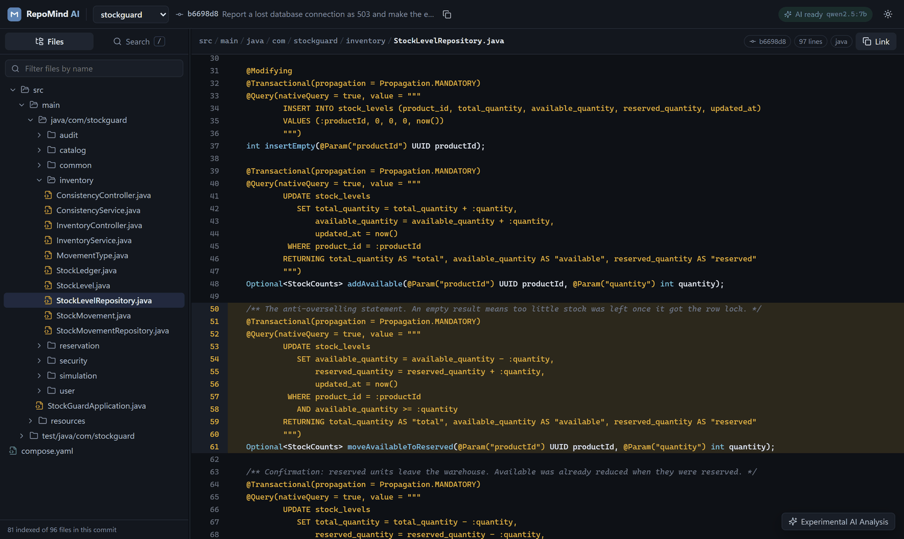
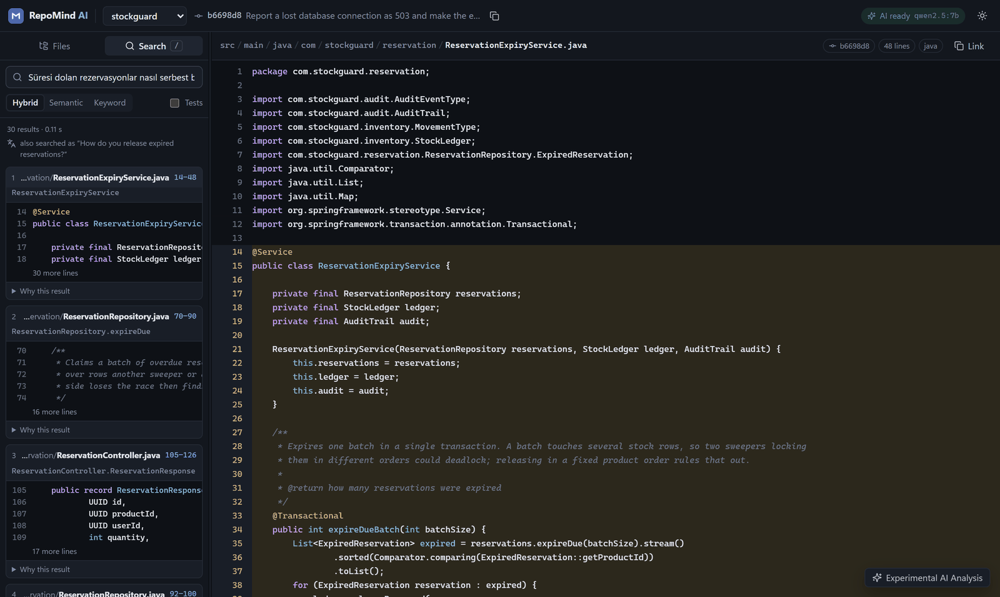
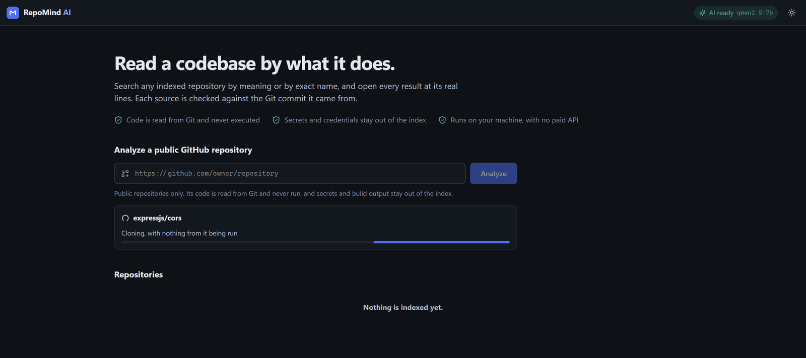

[🇹🇷 Türkçe](README.md) | [🇬🇧 English](README.en.md)

# RepoMind AI

**Bir kod tabanında bir işin nerede ve nasıl yapıldığını bulun, o işi yapan satırları birebir okuyun.**

RepoMind bir GitHub deposunu (repository) yerel olarak indeksler; depoyu gezmenizi, içinde arama yapmanızı ve ona Türkçe ya da İngilizce soru sormanızı sağlar. Her sonuç, geldiği Git commit'ine sabitlenmiş gerçek bir satır aralığıdır; böylece onu açabilir, bağlantısını paylaşabilir ve kendiniz kontrol edebilirsiniz. Kendi makinenizde çalışır. Varsayılan kurulum hesap, API anahtarı ya da ücretli bir API gerektirmez. OpenAI API'si isteğe bağlı bir seçenektir ve ücretlidir.

> **Durum: tek bir makinede tek bir kişi için çalışan, yerel bir web uygulaması.** Kodda arama yapmak ve kodu okumak güvenilir biçimde çalışır. **Yapay zekâ analizi deneyseldir ve sık sık yanılır:** `qwen2.5:7b` ile yapılan son ölçümde, yanıtlanabilir 32 sorunun 13'ünde tamamen doğru kaynağı, 6'sında ise yanlış bir kaynağı gösterdi. Gösterdiği her satırı okuyun. Bkz. [Yapay zekâ doğruluğu](#yapay-zekâ-doğruluğu).



## İçindekiler

- [Neden](#neden) · [Özellikler](#özellikler) · [Ekran görüntüleri](#ekran-görüntüleri) · [Nasıl çalışır](#nasıl-çalışır)
- [Windows'ta başlarken](#windowsta-başlarken): [önce bir depo ekleyin](#önce-bir-depo-ekleyin), [yapay zekâ analizi](#yapay-zekâ-analizi-isteğe-bağlı), [GPU ile veya GPU olmadan](#gpu-ile-veya-gpu-olmadan), [sık karşılaşılan sorunlar](#sık-karşılaşılan-sorunlar)
- [Kullanım](#kullanım) · [MCP sunucusu](#mcp-sunucusu) · [Yapay zekâ doğruluğu](#yapay-zekâ-doğruluğu) · [Güvenlik](#güvenlik) · [Testler](#testler)
- [Proje yapısı](#proje-yapısı) · [Bilinen sınırlamalar](#bilinen-sınırlamalar) · [Üçüncü taraf yazılımlar ve modeller](#üçüncü-taraf-yazılımlar-ve-modeller) · [Lisans](#lisans)

## Neden

Bir sohbet modeline tanımadığınız bir depo hakkında soru sormak, çoğu zaman var olmayan dosyaları, fonksiyonları ve ayarları adıyla anan, kendinden emin yanıtlar doğurur. RepoMind bunu tersine çevirir: önce arar ve her yanıt deponun kendi satırlarından oluşur. Her satır Git'e karşı doğrulanır; bir model kullanılıyorsa, model yalnızca bulunan satırlar arasından seçim yapar. Model, yanıta asla kendi yazdığı bir kodu ya da bilgiyi eklemez. Kanıt yetersiz kaldığında RepoMind "bilmiyorum" der.

## Özellikler

- **Herkese açık bir GitHub deposunu URL'siyle ekleyin.** Depo arka planda güvenli biçimde klonlanır, ayrıştırılır (parse) ve indekslenir; ilerleme gösterilir, hatalar anlaşılır biçimde bildirilir ve iş yeniden denenebilir.
- **Kodu commit'lendiği hâliyle gezin.** Bir dosya ağacı ile satır numaralı ve sözdizimi renklendirmeli bir kod görünümü; içerik, indekslenen commit'te Git'ten okunur. `…/blob/<commit>/src/App.ts#L12-L20` gibi bağlantılar her zaman aynı satırları açar; GitHub'dan eklenen bir depoda bir düğme aynı satırları GitHub'da da açar.
- **Kodda üç yolla arayın.** Anahtar kelime (BM25), anlamsal (pgvector ile vektör araması) ya da ikisini Reciprocal Rank Fusion (RRF) ile birleştiren hibrit arama. Her sonuç neden bulunduğunu gösterir ve kendi satırlarında açılır.
- **Türkçe veya İngilizce sorun.** Türkçe sorular yerel olarak çevrilir ve her iki ifade de aranır. Kod, tanımlayıcılar (identifier) ve yapılandırma anahtarları değiştirilmeden korunur.
- **Deneysel yapay zekâ analizi.** Varsayılan olarak Ollama üzerinde çalışan yerel bir model (`qwen2.5:7b`), bulunan satırlar arasından seçim yapar ya da hiçbirini seçmez. Onun yerine OpenAI API'si de kullanılabilir; ücretlidir ve ayrıca açılması gerekir. Git'te var olan satırlar, kanıt kuralını geçen satırlar ve modelin kendi cümlesi birbirinden ayrı ve etiketli olarak gösterilir.
- **Bir MCP sunucusu.** Claude Code gibi bir MCP istemcisi, üç salt okunur araç sunan yerel bir stdio sunucusu üzerinden, izin verilen depolarda arama yapabilir ve satırları indekslenen commit'te Git'ten okuyabilir: `list_repositories`, `search_code` ve `get_verified_source`. Sunucu hiçbir modele soru sormaz.
- **Varsayılan olarak yerel ve size özel.** Yalnızca `127.0.0.1` üzerinde dinler, embedding'ler CPU'da hesaplanır, GPU isteğe bağlıdır.
- **Depoları güvenilmez (hostile) kabul eder.** Kod asla çalıştırılmaz, gizli bilgiler (secrets) ve kimlik bilgileri (credentials) indekse girmez, koddaki prompt injection (istem enjeksiyonu) girişimlerinin etkisi sınırlandırılır ve her şey düz metin olarak gösterilir.

Java, TypeScript (TSX dahil), JavaScript, SQL ve YAML indekslenir. Diğer dosyalar sayımlarda görünür ama aranmaz.

## Ekran görüntüleri

Çalışan uygulamadan, [StockGuard](https://github.com/melihuur1/stockguard) ve herkese açık [`expressjs/cors`](https://github.com/expressjs/cors) depoları üzerinde alınmıştır. Hiçbirinde düzenleme yapılmamıştır.

**Türkçe sorulmuş bir hibrit arama.** Soru, İngilizce çevirisiyle de aranır; bu çeviri sonuç sayısının altında, *also searched as* satırında görünür. İlk sonuç kendi satırlarında açıktır.



**Herkese açık bir GitHub deposu ekleme.** Depo klonlanırken (içinden hiçbir şey çalıştırılmadan), ardından ayrıştırılıp embedding'leri hesaplanırken sayfa her adımı takip eder.



Bu sayfanın başındaki kod görünümü, indekslenen commit'teki bir Java dosyasını gösterir; dosya, 50-61. satırları seçen bir bağlantıyla açılmıştır.

## Nasıl çalışır

```mermaid
flowchart LR
    U["GitHub URL'si veya yerel depo"] --> G["Tek bir commit'teki Git nesneleri"]
    G --> F["Filtreler: gizli bilgiler, üretilmiş ve vendor dosyaları"]
    F --> T["Tree-sitter sözdizimi ağaçları, SQL ifadeleri, YAML yapısı"]
    T --> C["Parçalar, semboller, import'lar"]
    C --> E["Yerel embedding'ler"]
    C --> DB[(PostgreSQL + pgvector)]
    E --> DB
    Q["Türkçe veya İngilizce soru"] --> S["BM25 + vektör araması, RRF ile birleştirilir"]
    DB --> S
    S --> P["Git'e karşı doğrulanmış birkaç kısa pasaj"]
    P --> M["İsteğe bağlı LLM, varsayılanı yerel: pasajları seçer ya da hiçbirini seçmez"]
    M --> A["Deponun kendi satırları, etiketli kontrollerle"]
```



1. **Okuma:** Git'in nesne veritabanından tek bir commit okunur. Analiz edilen depolar asla değiştirilmez, checkout edilmez ya da çalıştırılmaz.
2. **Ayrıştırma:** Java, TypeScript ve JavaScript, Tree-sitter ile sözdizimine uygun parçalara (chunk) ayrılır; sembolleri ve import'ları da çıkarılır. SQL ifadelere (statement), YAML ise kendi yapısına göre bölünür.
3. **Dışarıda bırakma:** Gizli (hidden), üretilmiş (generated), üçüncü taraflardan kopyalanmış (vendored) ve derleme (build) dosyaları ile kimlik bilgisine benzeyen her şey dışarıda bırakılır.
4. **Embedding:** Parçaların embedding'leri yerel olarak hesaplanır; içerik bazında önbelleğe alındığı için değişmeyen kodun embedding'i asla iki kez hesaplanmaz.
5. **Arama:** BM25 ve pgvector ile aranır, sonuçlar Reciprocal Rank Fusion ile birleştirilir; Türkçe sorular yerel olarak çevrilir.
6. **Yanıtlama:** Sonuçlar, hiçbir model kullanılmadan birkaç kısa pasaja (passage) indirgenir; ardından isteğe bağlı bir LLM bunlar arasından seçim yapar. Her pasaj Git'e karşı doğrulanır; soruyla çok az ortak terimi olan satırlar kanıt sayılamaz.

| Katman | Teknoloji |
| --- | --- |
| Arka uç (backend) | Python 3.11+, FastAPI, Uvicorn |
| Ayrıştırma | Java, TypeScript, TSX ve JavaScript için Tree-sitter sözdizimi ağaçları (AST); ayrıca SQL ifadesi ve YAML yapısı bazında parçalama |
| Veri depolama | Docker'da, pgvector eklentili PostgreSQL 17 |
| Embedding'ler | [`intfloat/multilingual-e5-small`](https://huggingface.co/intfloat/multilingual-e5-small), 384 boyutlu; fastembed ve ONNX Runtime aracılığıyla CPU'da |
| Arama | BM25 ve kosinüs benzerliği, Reciprocal Rank Fusion ile birleştirilir |
| Çeviri | CTranslate2 üzerinden CPU'da çalışan Opus-MT (Türkçeden İngilizceye); LLM çalışıyorsa o da kullanılır |
| LLM (isteğe bağlı) | Varsayılan olarak Docker'daki Ollama üzerinde `qwen2.5:7b`. OpenAI uyumlu herhangi bir uç nokta (endpoint) ya da ücretli OpenAI API'si de kullanılabilir |
| MCP | MCP Python SDK 2.x ile yazılmış, stdio üzerinden çalışan yerel bir sunucu; isteğe bağlı `[mcp]` eki (extra) |
| Ön yüz (frontend) | React 19, TypeScript, Vite, TanStack Query, React Router, lowlight aracılığıyla highlight.js |
| Testler | pytest, Vitest, Edge veya Chrome'da Playwright |

Tasarım ve ödünleşimler (trade-off): [docs/architecture.md](docs/architecture.md) (İngilizce). Ölçümler: [docs/evaluation.md](docs/evaluation.md) (İngilizce).

## Windows'ta başlarken

| Gerekenler | Sürüm | Notlar |
| --- | --- | --- |
| Windows 10 veya 11 | | Windows 11'de geliştirildi ve test edildi. macOS ve Linux'ta da çalışması beklenir, ancak test edilmedi |
| [Python](https://www.python.org/downloads/) | 3.11 veya üzeri | 3.13 ile test edildi |
| [Node.js](https://nodejs.org/) | 20 veya üzeri | Yalnızca web istemcisini derlemek için. 26 ile test edildi |
| [Git](https://git-scm.com/download/win) | güncel herhangi bir sürüm | 2.51 ile test edildi |
| [Docker Desktop](https://www.docker.com/products/docker-desktop/) | WSL 2 ile | PostgreSQL'i ve isteğe bağlı olarak LLM'i çalıştırır |
| Bellek | notlara bakın | RepoMind süreci geliştirme makinesinde, Docker'ın dışında 1 ile 1,9 GB arası bellek kullandı. 7B model yaklaşık 6,4 GB daha gerektirir |
| GPU | gerekmez | Bir NVIDIA GPU, isteğe bağlı LLM'i hızlandırabilir |

PowerShell'de, projelerinizi tuttuğunuz klasörden:

```powershell
git clone https://github.com/melihuur1/repomind-ai.git
cd repomind-ai

py -3 -m venv .venv
.\.venv\Scripts\python.exe -m pip install -e ".[dev]"
Copy-Item .env.example .env

docker compose up -d db              # 127.0.0.1:55432 üzerinde PostgreSQL + pgvector

npm --prefix web ci
npm --prefix web run build           # web istemcisini web\dist içine derler

.\.venv\Scripts\python.exe -m repomind serve
```

<http://127.0.0.1:7321> adresini açın. Bunların hiçbiri API anahtarı gerektirmez. Komutlar sanal ortamın Python'unu doğrudan çağırır; böylece PowerShell'in betik çalıştırma ilkesi (execution policy) sanal ortamı etkinleştirmeye engel olmaz. macOS veya Linux'ta `python3 -m venv .venv`, `.venv/bin/python` ve `cp .env.example .env` kullanın.

### Önce bir depo ekleyin

`https://github.com/expressjs/cors` gibi herkese açık bir deponun adresini **Analyze a public GitHub repository** (herkese açık bir GitHub deposunu analiz et) alanına yapıştırın ve **Analyze** düğmesine basın. Siz çalışmaya devam ederken sayfa her adımı gösterir, iş bitince **Open** (aç) seçeneğini sunar.

İlk indeksleme, embedding ve çeviri modellerini (yaklaşık 0,6 GB) bir kez `.models\` klasörüne indirir. Sonrasında, bir dizüstü bilgisayar CPU'sunda küçük bir deponun indekslenmesi yaklaşık 10 saniye, 59 kaynak dosya ve 426 parçadan oluşan bir deponunki ise 27 saniye sürdü.

Bunun yerine diskinizde zaten bulunan, özel (private) de olabilecek bir depoyu indekslemek için:

```powershell
.\.venv\Scripts\python.exe -m repomind index --path "C:\path\to\repository"
```

### Yapay zekâ analizi (isteğe bağlı)

Arama, dosya ağacı ve kod görünümü model gerektirmez. Bulunan satırlar arasından yerel bir modelin seçim yapmasını istiyorsanız (hesap ya da API anahtarı gerekmez):

```powershell
docker compose --profile llm up -d ollama
docker exec repomind-ollama ollama pull qwen2.5:7b      # yaklaşık 4,7 GB, bir kez
```

Ardından `.env` dosyasındaki şu iki satırın başındaki `#` işaretini kaldırın ve `repomind serve` komutunu yeniden başlatın:

```bash
REPOMIND_LLM_BASE_URL=http://127.0.0.1:11535/v1
REPOMIND_LLM_MODEL=qwen2.5:7b
```

Model, RepoMind çalışırken başlatılıp durdurulabilir; üst çubuktaki durum göstergesi bunu takip eder. `docker compose stop ollama` modelin kullandığı belleği geri verir. Konteyner aynı anda yalnızca bir modeli yüklü tutar ve 8 GB ile sınırlıdır.

**Kendi sunucunuz.** Başka bir makinedeki daha büyük bir model de aynı ayarlarla çalışır: `.env.example` içindeki ilgili bölüme bakın. Her soru ve onun için seçilen kod satırları o sunucuya gönderilir. Bunun `REPOMIND_LLM_ALLOW_REMOTE=1` ile açıkça açılması gerekir; sayfa da uzak bir modelin kullanıldığını belirtir.

**OpenAI API'si.** İsteğe bağlıdır ve ücretlidir. Her soru ve onun için seçilen kod satırları OpenAI'ye gönderilir. Kimlik bilgisi içerebilecek satırlar önce çıkarılır; ancak bunu yapan kurallar tanımadıkları bir gizli bilgiyi kaçırabilir. RepoMind `store: false` gönderir; bu, OpenAI'den konuşmayı kendi ürünleri için saklamamasını ister. Hiçbir şeyin saklanmayacağına dair bir söz değildir: bunu OpenAI'nin kendi veri politikası belirler. Git'in yoksaydığı `.env` dosyasında:

```bash
REPOMIND_LLM_PROVIDER=openai
REPOMIND_LLM_MODEL=              # OpenAI'nin model listesinden, o gün kontrol edilerek
REPOMIND_LLM_API_KEY=            # hiçbir zaman Git'in izlediği bir dosyada değil
REPOMIND_LLM_ALLOW_REMOTE=1      # kodun gönderilmesine açık izin
REPOMIND_LLM_INPUT_USD_PER_MTOK=     # OpenAI'nin fiyat sayfasından, 0'dan büyük
REPOMIND_LLM_OUTPUT_USD_PER_MTOK=    # aynı şekilde
REPOMIND_LLM_CACHE_WRITE_USD_PER_MTOK=   # 30 dakikalık önbellek yazma fiyatı, 0'dan büyük
# REPOMIND_LLM_CACHED_INPUT_USD_PER_MTOK= # isteğe bağlı; yoksa önbellekten okumalar tam girdi fiyatıyla sayılır
REPOMIND_LLM_MAX_TOTAL_COST_USD=0.05 # RepoMind'ın sizin fiyatlarınızla tuttuğu sayım; kesin bir üst sınır değil
# REPOMIND_LLM_REASONING_EFFORT=low  # yalnızca akıl yürüten (reasoning) bir model için, kabul ettiği bir değerle
```

- **Burada hiçbir model ya da fiyat yazılı değildir.** İkisi de değişir; bu yüzden ikisini de o gün [OpenAI'nin model listesinden](https://platform.openai.com/docs/models) ve [fiyat sayfasından](https://openai.com/api/pricing/) alın.
- **Adres sabittir.** Adres `https://api.openai.com/v1`'dir ve anahtar asla başka bir yere, bir yönlendirmeden sonra da gönderilmez.
- **Önbellekli girdinin kendi fiyatları vardır.** OpenAI uzun bir prompt'un başını kendiliğinden önbelleğe alır. Her girdi token'ı üç fiyattan biriyle faturalanır: önbelleksiz, önbellekten okunan ya da önbelleğe yazılan. Yazma, önbelleksiz fiyatın üstüne eklenmez, onun yerine geçer. RepoMind her bölümü kendi fiyatıyla sayar. Bir istekten önce her girdi token'ını bu fiyatların en yükseğiyle hesaba katar.
- **Bütçe kesin bir üst sınır değildir.** RepoMind, girdiğiniz fiyatlarla tuttuğu kendi sayımı bir sonraki isteğin bütçeyi aşabileceğini gösterdiğinde artık istek göndermez.
  - Bütçe yine de aşılabilir: yanlış fiyatlarla, gerçek sayıdan düşük kalan bir token tahminiyle ya da aynı anda sorulan iki soruyla.
  - Bu sayım OpenAI'nin faturası değildir.
  - OpenAI projesinde de bir harcama sınırı koyun.
- **Türkçe bir soru iki istektir.** Model önce soruyu çevirir, sonra pasajlar arasından seçim yapar. Yalnızca arama yaptığınızda çeviri bu makinede yapılır ve hiçbir şey gönderilmez.
- **Yanlış bir ayar** üst çubukta **AI settings invalid** (yapay zekâ ayarları geçersiz) olarak adıyla gösterilir ve hiçbir istek gönderilmez.
- **Sayfanın gösterdikleri.** Yapay zekâ paneli modeli, neyin gönderildiğine dair notu ve RepoMind'ın sizin fiyatlarınızdan saydığı harcamayı gösterir; bu, OpenAI'nin faturası değildir. Ücretlendirilmiş olabileceği bir anda başarısız olan bir istek için en yüksek tutarla sayılan maliyet ayrıca işaretlenir.
- **OpenAI başarısız olduğunda** (anahtar reddedildiğinde, bir sınıra ulaşıldığında, bütçe bittiğinde ya da OpenAI'ye ulaşılamadığında) soru yine de aramanın bulduğu en yakın satırları döndürür ve nedenini söyler.
- **Geri dönmek için** `REPOMIND_LLM_PROVIDER` satırını ve anahtarı kaldırın, iki yerel satırı geri getirin.

İlk gerçek istekten önce [docs/openai-first-run.md](docs/openai-first-run.md) (İngilizce) belgesini okuyun.

### GPU ile veya GPU olmadan

**GPU olmadan** hiçbir şey değişmez: varsayılan budur ve yalnızca isteğe bağlı LLM daha yavaş çalışır. Geliştirme makinesinde tek bir Türkçe soru, modelin yüklenmesi dahil, CPU'da yaklaşık 50 saniye sürdü.

**NVIDIA GPU ile** şu iki satırı `.env` dosyasına ekleyin ve `docker compose --profile llm up -d ollama` komutunu yeniden çalıştırın. Modelin GPU belleğine sığan katmanları orada çalışır. 4 GB'lık bir RTX 3050'de aynı soru yaklaşık 12 saniye sürdü.

```bash
COMPOSE_PATH_SEPARATOR=,
COMPOSE_FILE=compose.yaml,compose.gpu.yaml
```

Bunlar tek bir makinede ölçülmüş tekil sorulardır; kıyaslama (benchmark) sonucu değildir.

### Sık karşılaşılan sorunlar

| Gördüğünüz | Nedeni | Yapılacak |
| --- | --- | --- |
| `Port 7321 cannot be used` | Portu başka bir program kullanıyor ya da Windows bu port aralığını ayırmış | `repomind serve` komutuna `--port 7400` ekleyin ya da başka boş bir port seçin |
| `The web client is not built` | `web\dist` henüz yok | `npm --prefix web ci`, ardından `npm --prefix web run build`. Yeniden başlatma gerekmez |
| Sayfa depoları yükleyemiyor ve `/api/health` `"database": false` bildiriyor | Veritabanı konteyneri çalışmıyor | `docker compose up -d db`, ardından `docker compose ps` ile kontrol edin |
| Üst çubukta **AI not set up** (yapay zekâ ayarlanmadı) | `.env` içinde model yapılandırılmamış | Bkz. [Yapay zekâ analizi](#yapay-zekâ-analizi-isteğe-bağlı) |
| **AI offline** (yapay zekâ çevrim dışı) | Ollama çalışmıyor | `docker compose --profile llm up -d ollama` |
| **AI model missing** (model eksik) | Model indirilmemiş (pull edilmemiş) | `docker exec repomind-ollama ollama pull qwen2.5:7b` |
| **AI paused** (yapay zekâ duraklatıldı) | 4 GB'tan az boş bellek var | Bazı programları kapatın ve yeniden sorun |
| **AI settings invalid** (yapay zekâ ayarları geçersiz) | `.env` içindeki bir model ayarı hatalı; örneğin anahtar ya da fiyatlar olmadan `REPOMIND_LLM_PROVIDER=openai` | Yapay zekâ paneli ilgili ayarın adını verir |
| **AI key refused** (anahtar reddedildi) | OpenAI anahtarı kabul etmedi (HTTP 401 veya 403) | `REPOMIND_LLM_API_KEY` değerini ve anahtarın etkin olduğunu kontrol edin |
| **AI budget spent** (bütçe tükendi) | Bir sonraki istek `REPOMIND_LLM_MAX_TOTAL_COST_USD` değerini aşabilir | Daha fazla harcama gerçekten isteniyorsa değeri artırın |
| **AI limited** (yapay zekâ sınırlandı) | OpenAI'nin kotası, harcama sınırı ya da istek hızı sınırı | Yapay zekâ paneli hangisi olduğunu söyler. Hız sınırı kendiliğinden geçer; kota için OpenAI hesabında işlem gerekir |
| **AI request refused** (istek reddedildi) | OpenAI isteği kabul etmedi; çoğunlukla modelin almadığı bir parametre yüzünden | Akıl yürüten bir model için `REPOMIND_LLM_REASONING_EFFORT` ayarlayın |
| `GitHub is limiting requests from this machine` | GitHub'ın anonim API'si saatte yaklaşık 60 isteğe izin verir | Bekleyin, ardından **Retry** (yeniden dene) düğmesine basın |
| `Git on Windows cannot write a clone this deep in the folder tree` | Klonun yolu 260 karakteri aşacak | `.env` içinde `REPOMIND_DATA_DIR=C:\repomind-data` ayarlayın ya da projeyi kısa bir yolda tutun |
| `npm ci` sırasında `npm warn install-scripts … esbuild` | npm 11, onaylanmadıkça kurulum betiklerini (install scripts) çalıştırmaz | Zararsızdır: derleme bu betik olmadan da çalışır |
| Sembolik bağlantılarla (symlink) ilgili bir Hugging Face uyarısı | Geliştirici Modu (Developer Mode) kapalı bir Windows | Zararsızdır. `HF_HUB_DISABLE_SYMLINKS_WARNING=1` uyarıyı susturur |

## Kullanım

Arayüz İngilizcedir. Aşağıda düğme ve etiketler arayüzdeki özgün adlarıyla yazılmış, anlamları Türkçe açıklanmıştır.

- **Repositories (depolar):** Neyin indekslendiğini; commit'i, dilleri ve sayılarıyla gösterir. URL ile eklenen depolar kaldırılabilir; bu yalnızca RepoMind'ın indeksini ve klonunu siler. Yeni commit'leri almak için aynı adresi yeniden ekleyin. Aynı commit asla iki kez indekslenmez.
- **Files (dosyalar):** Bir aralık seçmek için satır numaralarına tıklayın, birden çok satır için Shift'i kullanın ve bağlantıyı kopyalayın. **GitHub** düğmesi aynı satırları GitHub'da açar.
- **Search (arama)** (`/` tuşu imleci arama kutusuna götürür): Çoğu soruya hibrit (Hybrid) arama uyar; anahtar kelime (Keyword) araması `cancelReservation` veya `token-ttl` gibi tam adlar için, anlamsal (Semantic) arama ise bir şeyi tarif eden sorgular için uygundur. **Tests** kutusunu işaretlemediğiniz ya da soru testlerden söz etmediği sürece test kodu dışarıda bırakılır.
- **Experimental AI Analysis (deneysel yapay zekâ analizi):** Açık olan depo hakkında Türkçe veya İngilizce soru sorun. Bir yanıtın her bölümünün anlamı:

| Görünen etiket | Anlamı | Anlamına gelmeyen |
| --- | --- | --- |
| **In Git at `abc1234`** (Git'te, `abc1234` commit'inde var) | Bu satırlar o commit'te birebir bu hâliyle vardır. Bu doğrulanır | Soruyu yanıtladıkları |
| **The model chose these lines** (model bu satırları seçti) | Model bu satırları seçti ve satırlar soruyla, kanıt kuralını geçecek kadar ortak kelime paylaşıyor | Doğru oldukları. Bu modelin yargısıdır ve sık sık yanılır |
| **Model's reading** (modelin yorumu) | Modelden gelen tek bir cümle; daraltılmış (collapsed) bir bölümde, doğrulanmamış olarak işaretlenmiş hâlde gösterilir | Doğru olduğu. Bu tür cümlelerin var olmayan özellikler anlattığı görüldü |
| **Not enough evidence** (yeterli kanıt yok) | "Bilmiyorum": hiçbir satır kontrolü geçmedi | Kodda bunun kesinlikle bulunmadığı. Arama bazı şeyleri kaçırır |
| **Source to review** (incelenecek kaynak) | Model burayı gösterdi, ancak kanıt kuralı kabul etmedi | Bir yanıt olduğu |
| **Closest lines found** (bulunan en yakın satırlar) | Aramanın bulduğu satırlar; hiçbir model bunları değerlendirmedi | Bir yanıt olduğu |
| **AI unavailable** (yapay zekâ kullanılamıyor) | Modele sorulmadı: model kapalı, bellek az, anahtarı reddedildi, bütçesi bitti ya da bir sınıra ulaşıldı. Aşağıdaki satırları yalnızca arama buldu ve nedeni belirtilir | Bir arıza olduğu: geri kalan her şey çalışmaya devam eder |

## MCP sunucusu

`python -m repomind.mcp_server`, Claude Code gibi bir MCP istemcisinin RepoMind'ın indeksinde arama yapmasını ve doğrulanmış satırları okumasını sağlar. MCP Python SDK ile yazılmış, stdio üzerinden çalışan yerel bir sunucudur. Hiçbir ağ portu açmaz ve hiçbir modele soru sormaz. Yukarıdaki kurulum komutu SDK'yı zaten kurar; tek başına kurmak için isteğe bağlı `[mcp]` ekini (extra) kullanın.

| Araç | Döndürdüğü |
| --- | --- |
| `list_repositories` | Gösterebileceği depolar; indekslenen commit'leri, indeks sürümleri ve aranıp aranamayacakları |
| `search_code` | RepoMind'ın tek bir depodaki hibrit, anahtar kelime ya da anlamsal araması, en fazla 20 sonuç. Her sonuç indekslenen commit'te Git'e karşı kontrol edilir. Eşleşmeyen ya da kimlik bilgisi içerebilecek bir sonuç dışarıda bırakılır |
| `get_verified_source` | İndekslenmiş bir dosyanın en fazla 200 satırı; indekslenen commit'te Git'ten okunur, kimlik bilgisi içeren satırlar gizlenir |

**Bağlamadan önce gerekenler:**
- **Bu sürümle indekslenmiş bir depo.** Önce web uygulamasında ya da `repomind index` ile bir depo indeksleyin. `python -m repomind repos` adları listeler ve eski bir sürümle indekslenmiş depoyu `OUTDATED` olarak işaretler. Sunucu böyle bir depoyu sunmaz: önce yeniden indeksleyin.
- **İkisi de zorunlu iki ayar:**
  - `REPOMIND_MCP_DATABASE`: indeksi tutan veritabanının adı, yalnızca adı. Sunucu, kullanıcı ve parola `REPOMIND_DATABASE_URL` ayarından alınır.
  - `REPOMIND_MCP_REPOSITORIES`: gösterebileceği depolar, virgülle ayrılmış olarak.
- **Çalışan bir veritabanı:** `docker compose up -d db`.

**Claude Code'a bağlamak.** PowerShell'de, proje klasöründen; köşeli parantez içindeki iki değerin yerine kendi veritabanı ve depo adlarınızı yazarak:

```powershell
claude mcp add -e REPOMIND_MCP_DATABASE=<database> -e REPOMIND_MCP_REPOSITORIES=<repository> --scope local repomind '--' "$PWD\.venv\Scripts\python.exe" -m repomind.mcp_server
claude mcp get repomind
```

- **`'--'` etrafındaki tırnaklar gereklidir.** Windows PowerShell'de `claude` bir betik olarak çalışır ve tırnaksız bir `--` ona ulaşmaz. Başka bir kabukta `--` yazın ve `.venv` içindeki Python'un yolunu verin.
- **Kaydın tutulduğu yer.** `--scope local` kaydı yalnızca bu klasöre özel olarak, Claude Code'un kendi ayarlarında tutar. Depoya hiçbir şey yazılmaz.
- **Kontrol etmek için.** `claude mcp get repomind` çıktısında `Connected` görünmelidir. Claude Code içinde `/mcp` sunucuyu gösterir.
- **Her araç çağrısı sizden izin ister;** siz o araca izin vermediğiniz sürece.

**Uyduğu kurallar:**
- Yalnızca listelenen depolar ve yalnızca bu sürümle yapılmış indeksler.
- Salt okunur bir veritabanı oturumu.
- `get_verified_source` yalnızca indeksin listelediği yolları, indekslenen commit'te Git'ten okur; çalışma klasöründen asla okumaz. Git'in verdiği baytlar indekslenen dosya değilse hiçbir şey döndürmez.
- Kimlik bilgisi içeren satırlar, birden fazla satıra yayıldıklarında da gizlenir.
- Bir yanıt en fazla yaklaşık 12.000 karakter kod içerir.
- Her sonuç deponun verisi olarak işaretlenir; bu veri sizden gelmeyen talimatlar içerebilir.

**Sonuçların gittiği yer.** Bir MCP istemcisi sunucunun döndürdüğünü kendi modeline iletir; Claude Code bunu Anthropic'e gönderir. Döndürülen kod makinenizden bu yolla çıkar; bu yüzden yalnızca o sağlayıcıyla paylaşabileceğiniz depoları listeleyin. Bir arama sonucu ya da kaynak satırı okunacak koddur, doğrulanmış bir yanıt değildir.

Ayrıntılar: [docs/architecture.md](docs/architecture.md#mcp-server) (İngilizce).

## Yapay zekâ doğruluğu

Yanıt katmanı iki gerçek proje üzerinde ölçüldü: [StockGuard](https://github.com/melihuur1/stockguard) (Java) ve [SyncNotes](https://github.com/melihuur1/syncnotes) (TypeScript). **Son ölçüm, önceden belirlenen kendi hedeflerini tutturamadı.** Çalıştırmadan önce sabitlenen ve `qwen2.5:7b` ile yalnızca bir kez çalıştırılan 24 Türkçe soruluk set şu sonuçları verdi:

| Son set, Türkçe, `qwen2.5:7b` | Sonuç | Önceden belirlenen hedef |
| --- | --- | --- |
| Doğru kaynak, 16 yanıtlanabilir sorudan | 8 | en az 8 |
| Yanlış kaynak, 16 sorudan | **4** | en fazla 2 |
| Yanıt yok, 16 sorudan | 4 | |
| Reddedilen yanıtlanamaz sorular, 8 sorudan | **6** | en az 7 |
| Var olmayan dosya veya satır referansları | 120'de 0 | 0 |
| Notlandırma: doğru, kısmen doğru, yanlış | 9, 1, 2 | |
| Soru başına ortalama süre | 6,6 sn | |

Kısacası: cevabı depoda bulunan 16 sorunun yalnızca yarısında doğru kaynak gösterildi; 4'ünde gösterilen kaynak yanlıştı, 4'ünde ise hiç yanıt verilmedi. Cevabı depoda olmayan 8 sorudan 6'sı doğru biçimde reddedildi, 2'si ise yanıt aldı. 120 dosya ve satır referansının hiçbiri uydurma değildi; ancak bu yalnızca satırların var olduğunu gösterir, soruyu yanıtladıklarını değil.

- **Gösterilen her satır Git'te vardır; ama bu, o satırı bir yanıt yapmaz.** 16 sorunun 6'sında doğru satırlar modele hiç ulaşmadı (3'ünde aramada, 3'ünde pasaj seçiminde kayboldu); 2'sinde ise model başka satırları seçti.
- **Kaynağı bulmak ile onu seçmek ayrı sorunlardır.** StockGuard'ın stoğun negatife düşmesini nasıl engellediği sorulduğunda, bunu sağlayan veritabanı kısıtları (constraint) artık her seferinde modele sunuluyor; buna rağmen model çoğunlukla, negatif sayaçları yalnızca bir çalıştırmanın ardından tespit eden kodu seçiyor. [Sonraki bir değişiklik](docs/architecture.md#a-question-that-names-its-repository) (İngilizce), soru deponun adını andığında modele neyin ulaştığını düzeltti; modelin neyi seçtiğini değil.
- **Bu bağımsız bir test değildir.** Soruları ve sistemi aynı geliştirici yazdı, yanıtları tek bir değerlendirici notlandırdı. 24 soru, genelleme yapmak için çok azdır.

**2026-11-15'teki sonraki bir karşılaştırmada 48 yeni soru bir kez soruldu.** `qwen2.5:7b` ile yanıtlanabilir 32 sorunun 13'ünde tamamen doğru kaynak, 5'inde gereken iki yerden biri, 6'sında yanlış kaynak gösterildi; 7'si yanıtsız kaldı ve 1'inde model kullanılamaz bir yanıt verdi. Yanıtlanamaz 16 sorunun 14'ü reddedildi. Bundan önce yayımlanan sürüm aynı sorularda 12 tam doğru kaynak bulmuştu; yani bu daldaki değişikliklerin yanıtları **iyileştirdiği gösterilemedi**. Yanlış kaynakların hepsi Türkçe sorulardaydı. Kaydın tamamı [eval/V2_EVALUATION.md](eval/V2_EVALUATION.md) (İngilizce) belgesindedir. Bundan sonra modele ulaşan ve kabul edilen satırlarda yapılan değişiklikler bir modelle ölçülmedi.

Her iki ölçüm de `qwen2.5:7b` ile yapıldı. OpenAI modelleri dahil başka hiçbir model RepoMind'da ölçülmedi; bu yüzden sayfa bu doğruluk bilgisini yalnızca `qwen2.5:7b` için verir, diğer modeller için değerlendirilmediklerini söyler.

Aramanın kendisi ayrıca ölçüldü: 85 Türkçe geliştirme sorusunun (sistemin üzerinde ayarlandığı sorular; bağımsız bir ölçüm değildir) 65 ila 68'inde doğru kod beş pasaja ulaşıyor. Projenin buraya nasıl geldiği (reddedilen bir reranker, bir pilot çalışma ve yine geçemeyen dördüncü bir soru seti dahil), her sonuç olduğu gibi aktarılarak [docs/evaluation.md](docs/evaluation.md) (İngilizce) belgesinde anlatılır.

## Güvenlik

RepoMind yabancıların yazdığı kodu okur; bu yüzden hem depoyu hem de deponun adresini güvenilmez (hostile) kabul eder:

- **Adresler:** Yalnızca `https://github.com/owner/name` biçimi kabul edilir. Her istek, sahip (owner) ve ad (name) bilgisinden yeniden oluşturulur; böylece başka bir sunucuya ya da yerel bir servise ulaşamaz. Özel (private) depolar reddedilir.
- **Klonlama:** Yalnızca Git'in kendi nesneleri yazılır; çalışma dosyaları, hook'lar, submodule'ler, filtreler ya da LFS kullanılmaz. Yalnızca HTTPS'e izin verilir ve Git yönlendirmeleri kapalıdır. Bu makinenin Git ayarları ve kayıtlı kimlik bilgileri sürece dahil olmaz.
- **Sınırlar, tümü [yapılandırılabilir](.env.example):** GitHub'da 300 MB, klonlanmış hâlde 600 MB, 20.000 dosya, 5.000 kaynak dosya, 100 MB kaynak kod, klonlama için 5 dakika ve toplamda 30 dakika. Boş bellek 4 GB'ın altındaysa indeksleme başlamaz.
- **Gizli bilgiler (secrets):** Kimlik bilgisine benzeyen dosya ve satırlar asla indekslenmez ya da gösterilmez; bir modele gönderilenlerin de dışında tutulur. İndeks sürümü 3'ten önce yapılmış bir indeks, koda yazılmış kimlik bilgilerini hâlâ saklar. Bunlar aramada ve prompt'tan önce yeniden süzülür, eski indeks de eski olarak işaretlenir: bkz. [docs/openai-first-run.md](docs/openai-first-run.md) (İngilizce).
- **Tek kişi, tek makine:** `repomind serve` yalnızca 127.0.0.1 üzerinde dinler ve başka bir adresi reddeder. Giriş, kullanıcı başına sınır ya da istek hızı sınırı yoktur; bu yüzden olduğu gibi herkese açık internete açılmamalıdır, bir tünel ya da proxy üzerinden de. Ayarlarında bir API anahtarı varsa bu daha da önemlidir.
- **Uzak bir model ya da OpenAI API'si, yalnızca seçilirse:** Kod oraya yalnızca `REPOMIND_LLM_ALLOW_REMOTE=1` ile gönderilir. OpenAI adresi sabittir, yönlendirmeler izlenmez ve anahtar yalnızca `.env` dosyasından okunur. Anahtar hiçbir yanıtta, log'da ya da hata mesajında görünmez.
- **MCP sunucusu:** Salt okunurdur; yalnızca ayarlarında listelenen depolar ve yalnızca bu sürümle yapılmış indeksler için çalışır. Döndürdükleri, MCP istemcisinin model sağlayıcısına gider: bkz. [MCP sunucusu](#mcp-sunucusu).
- **Prompt injection:** Kod modele, kapatamayacağı etiketlerin (tag) içinde ulaşır; model pasajlara yalnızca kimlikleriyle (id) atıfta bulunur ve yanıtı kontrol edilir.
- **Tarayıcı:** Depodan gelen her şey, katı bir içerik güvenlik politikasının (Content Security Policy) arkasında düz metin olarak gösterilir. Sunucu yalnızca kendi ana makine adlarına (host name) yanıt verir ve değişiklikleri yalnızca kendi sayfalarından kabul eder; böylece başka bir web sitesi onu yönetemez.

Ayrıntılar: [docs/architecture.md](docs/architecture.md#web-application) (İngilizce).

## Testler

```powershell
.\.venv\Scripts\python.exe -m pytest        # ayrıştırma, arama, yanıtlar, API, indeksleme, MCP, güvenlik
npm --prefix web test                       # web istemcisinin kendi mantığı
npm --prefix web run build                  # tipleri de kontrol eder
npm --prefix web run test:e2e               # Playwright, kurulu Edge tarayıcısında
```

2026-11-23'te, dışarıya HTTPS erişimi engellenmişken 1.682 Python testi geçti ve 1'i atlandı; 45 Vitest ve 53 Playwright testi de geçti.

OpenAI sağlayıcısının kendi testleri vardır; bunlar OpenAI'ye hiçbir istek göndermez ve uydurma bir anahtar kullanır. Diğerleriyle birlikte ya da tek başlarına çalışırlar:

```powershell
.\.venv\Scripts\python.exe -m pytest tests/test_openai_config.py tests/test_openai_client.py tests/test_openai_services.py tests/test_openai_api.py
```

MCP sunucusunun testleri onu ayrıca kendi sürecinde başlatır, onunla ham JSON-RPC ile konuşur ve loopback dışında hiçbir adrese ulaşmadığını kontrol eder.

Veritabanına, çalışan bir LLM'e ya da değerlendirilen depolara ihtiyaç duyan testler, bunlar yoksa kendilerini atlar. Gerçek bir modele soru soran tek test yalnızca `REPOMIND_RUN_LLM_TESTS=1` ile çalışır ve `.env` içinde yapılandırılmış modeli kullanır. OpenAI API'si yapılandırılmışsa bu gerçek bir istektir ve ücretlidir. Tarayıcı testleri gerçek API'yi, veritabanını, Git'i ve klonlama komutunu; dosya adlarında, kodunda ve commit mesajlarında gizli bilgiler, prompt injection ve HTML işaretlemesi (markup) barındıran bir test deposu (fixture) üzerinde çalıştırır. Yalnızca modellerin ve GitHub'ın yerine sahteleri kullanılır; bu yüzden ağ, GPU ya da model gerekmez. `REPOMIND_E2E_BROWSER=chrome` ile Edge yerine Chrome kullanılır.

<details>
<summary>Komut satırı ve değerlendirmeyi yeniden üretme</summary>

```powershell
.\.venv\Scripts\python.exe -m repomind repos
.\.venv\Scripts\python.exe -m repomind search "Stok tutarlılığı nasıl sağlanıyor?" --repo stockguard
.\.venv\Scripts\python.exe -m repomind search "cancelReservation" --mode keyword --explain
.\.venv\Scripts\python.exe -m repomind ask "Rezervasyon iptali nerede yönetiliyor?" --repo stockguard
```

Değerlendirmeyi yeniden üretmek için iki depoyu klonlayın, `.env` içinde `REPOMIND_REPO_STOCKGUARD` ve `REPOMIND_REPO_SYNCNOTES` değerlerini ayarlayın ve sabitlenmiş (pinned) commit'leri, yani ölçümün yapıldığı commit'leri indeksleyin:

```powershell
.\.venv\Scripts\python.exe -m repomind index --path "C:\path\to\stockguard" --name stockguard --ref b6698d81475232f2b8ca95af45336fae5665cd81
.\.venv\Scripts\python.exe -m repomind index --path "C:\path\to\syncnotes" --name syncnotes --ref bb217cddc89088f27b68715cf9585e94ce2fe3a6
.\.venv\Scripts\python.exe -m repomind evaluate --dataset eval/questions_v2.yaml
.\.venv\Scripts\python.exe -m repomind evaluate-ask --dataset eval/questions_v5.yaml --output eval/results/my-run.json
```

`evaluate-ask` yapılandırılmış bir LLM gerektirir. OpenAI API'siyle her soru ücretli bir istektir, Türkçe bir soru ise iki istek. Her soruyu bittiği anda kaydeder ve durdurulursa kaldığı yerden devam eder; 3 GB'tan az boş bellek varsa başlamaz ve `--overwrite` verilmedikçe tamamlanmış bir sonucun üzerine asla yazmaz. Sorular ve altın (gold) etiketler, ölçtükleri koddan önce commit'lendi; her altın aralık (gold span), sabitlenmiş commit'e karşı bir testle kontrol edilir. Bkz. [docs/evaluation.md](docs/evaluation.md#reproducing) (İngilizce).

</details>

## Proje yapısı

```text
repomind/          Python paketi
  ingest/          Git okuma, filtreler, güvenli GitHub klonlama
  parsing/         Tree-sitter, SQL ve YAML parçalama
  embeddings/      yerel embedding modelleri
  search/          BM25, vektör araması, birleştirme (fusion), çeviri, terim sözlüğü
  qa/              pasajlar, kanıt kuralı, prompt'lar, doğrulama, ask motoru
  store/           PostgreSQL şeması ve sorguları
  api/             FastAPI uygulaması ve arka planda indeksleme
  mcp_server/      yerel MCP sunucusu ve üç aracı
  evaluation/      değerlendirme çalıştırıcıları ve metrikler
web/               React ve TypeScript istemcisi, Vitest ve Playwright testleriyle
eval/              soru setleri, altın etiketler, sonuçlar ve araçlar
docs/              mimari, değerlendirme ve planlar (İngilizce)
compose.yaml       PostgreSQL ve llm profilinde Ollama
compose.gpu.yaml   Ollama için isteğe bağlı NVIDIA GPU
```

## Bilinen sınırlamalar

- **Yapay zekâ yanıtları güvenilir değildir;** [yukarıdaki ölçümde](#yapay-zekâ-doğruluğu) görüldüğü gibi. Onları kodu bulmak için kullanın ve kodu okuyun.
- **Modelin cümleleri yanlış olabilir.** Doğrulanmamış olarak etiketlenirler.
- **Doğrulanmış bir satır, kanıtlanmış bir yanıt değildir.** Satırlar Git'e karşı kontrol edilir; soruyu yanıtlayıp yanıtlamadıkları kontrol edilmez.
- **Türkçe, aramada İngilizceden daha zayıftır** ve kusurlu bir çeviriye dayanır.
- **Tek bir makinede tek bir kişi içindir.** Hesap, kota ya da sandbox yoktur; bu yüzden `127.0.0.1` dışına açılmamalıdır.
- **URL ile yalnızca herkese açık GitHub depoları** eklenebilir; bu, saatte yaklaşık 60 isteğe izin veren GitHub'ın anonim API'si üzerinden yapılır. Yerel depolar komut satırından indekslenebilir.
- **Depo başına tek commit:** varsayılan dalın (branch) en son commit'i.
- **Beş dil** indekslenir: Java, TypeScript, JavaScript, SQL ve YAML.
- **Embedding'ler CPU'da hesaplanır;** bu yüzden büyük bir deponun indekslenmesi zaman alır. URL ile şimdiye kadar eklenen en büyük depo 426 parçadan oluşuyordu ve 27 saniye sürdü.
- **Gizli bilgi tespiti desen (pattern) tabanlıdır.** Bilinen token biçimlerini ve kimlik bilgisi anahtarlarını tanır; koda gömülü her parolayı değil.
- **Arayüz düzeni masaüstü penceresi içindir;** yaklaşık 1000 piksel genişliğe kadar.
- **Değerlendirme küçüktür:** iki depo; etiketleme ve notlandırma tek bir kişi tarafından yapıldı.
- **Hiçbir OpenAI modeli** RepoMind'da ölçülmedi. Yukarıdaki doğruluk sayıları yalnızca `qwen2.5:7b` içindir.
- **MCP sunucusunun döndürdükleri makineden çıkar;** istemcinin model sağlayıcısı üzerinden. Sunucunun kendine ait bir veritabanı rolü yoktur; oturumu salt okunurdur.

Listenin tamamı [docs/architecture.md](docs/architecture.md#known-limitations) (İngilizce) belgesindedir.

## Üçüncü taraf yazılımlar ve modeller

Modeller çalışma zamanında indirilir ve hiçbir zaman bu deponun parçası değildir:

| Model | Kullanım amacı | Lisans |
| --- | --- | --- |
| [`intfloat/multilingual-e5-small`](https://huggingface.co/intfloat/multilingual-e5-small) | Embedding'ler | MIT |
| [`gaudi/opus-mt-tr-en-ctranslate2`](https://huggingface.co/gaudi/opus-mt-tr-en-ctranslate2), [Helsinki-NLP Opus-MT](https://huggingface.co/Helsinki-NLP/opus-mt-tr-en) modelinden | Türkçeden İngilizceye çeviri | Apache-2.0 |
| [`qwen2.5:7b`](https://ollama.com/library/qwen2.5), isteğe bağlı | Pasaj seçimi | Apache-2.0 |

`qwen2.5:3b` de çalışır, ancak açık kaynak bir lisans yerine Qwen Research License ile lisanslanmıştır. Python ve npm bağımlılıkları MIT, BSD, Apache-2.0 ve ISC gibi serbest (permissive) lisanslara sahiptir; istisnalar `psycopg` (LGPL-3.0), `certifi` (MPL-2.0) ve `tqdm` (MPL-2.0 ve MIT) olup bunlar değiştirilmeden, kütüphane olarak kullanılır. Konteynerler PostgreSQL üzerinde [pgvector](https://github.com/pgvector/pgvector) ve [Ollama](https://github.com/ollama/ollama) çalıştırır.

## Lisans

[MIT](LICENSE), © 2026 Melih Uğur. Bu lisans RepoMind'ın kendi kodunu kapsar. Yukarıdaki bağımlılıklar ve modeller kendi lisanslarına tabidir.
