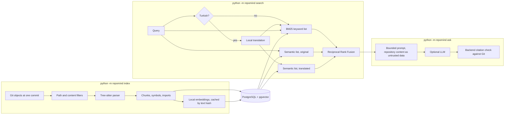

# Architecture

RepoMind's first phase is a retrieval and answering engine with a command line interface. There is deliberately no web application, user management, GitHub API integration or job queue yet: those come only after the core is shown to find the right code.

## Reading source code

`repomind/ingest/git_source.py` reads only from Git's object database (`rev-parse`, `ls-tree`, `cat-file`). This one decision settles several requirements:

| Requirement | How reading Git objects meets it |
| --- | --- |
| Citations must match a commit | Content is, by definition, the content of that SHA |
| Do not modify analyzed projects | Plumbing commands run with `GIT_OPTIONAL_LOCKS=0`; a test compares `.git` file timestamps before and after |
| Never run analyzed code | Only `cat-file` output reaches the parser; hooks and filters are not involved, and `core.fsmonitor` is forced off |
| Keep uncommitted secrets out | `.env` files in the working tree are unreachable, and uncommitted edits are ignored |
| No copies of other projects | No snapshot folder is needed |

A `.env` that *was* committed is still reachable through Git, so the filters below apply as well.

## Filtering

`repomind/ingest/filters.py` runs path rules before any content is read:

- any path segment starting with `.` (`.env`, `.git`, `.github`, hidden files);
- dependency and build folders: `node_modules`, `target`, `dist`, `build`, `vendor`, `out`, `coverage` and similar;
- files whose name starts with the word `secret`, `secrets`, `credential`, `credentials` or `creds` (so `secrets.ts`, but not `SecretRotationService.java`), or that carry an `.env.` segment (`prod.env.js`);
- generated files (`*.d.ts`, `*.min.js`, bundles), files over 1 MB, and unsupported languages.

Content rules then reject binary files, non-UTF-8 files, minified code, and files matching high-confidence credential patterns (private keys and AWS, GitHub, OpenAI, Anthropic, Google and Slack tokens). The report names such a file but never its secret. This scan does not catch generic values such as `password = "..."`; see [limitations](#known-limitations).

## Parsing and chunking

`repomind/parsing/chunker.py` uses Tree-sitter grammars for Java, TypeScript, TSX and JavaScript. Source is parsed, never evaluated.

| Situation | Result |
| --- | --- |
| Class of up to 40 lines | One chunk |
| Larger class | A header chunk (doc comment, annotations, leading fields) plus member chunks |
| Adjacent members of up to 3 lines, such as getters | One grouped chunk |
| Comment or decorator directly above a declaration | Stays with the declaration |
| Callable over 60 lines or 1500 characters | Split at statement boundaries; a statement that does not fit is split inside its block; raw lines are the last resort |
| Non-declaration top-level code | Merged into `module` chunks |
| `import` statements | Stored as structured rows, not retrievable chunks: they carry no behaviour, yet would rank highly for any query naming a library |

**Line references are exact by construction.** A chunk's `content` is always the lines `start_line..end_line` joined by `\n`, and `\n` is the only line separator. `str.splitlines` is deliberately not used: it also breaks on form feeds and U+2028, which would silently shift every later line number away from what Tree-sitter and Git report.

The parts of a split function stay contiguous and cover it completely. Later parts do not contain the signature, so it is added to the embedded text.

## Storage

PostgreSQL 17 with pgvector runs in RepoMind's own Compose project, on `127.0.0.1:55432`. The schema is in `repomind/store/schema.sql`:

- `repositories`, `snapshots` (one per indexed commit), `files`, `chunks`, `symbols`, `imports`. A new commit replaces the previous snapshot in a single transaction, so a failure cannot leave a half-written index.
- `embeddings`, keyed by `(text_hash, model)` and independent of snapshots. Unchanged code is never embedded twice, across commits and repositories, and interrupted runs resume because each batch commits on its own.
- `llm_usage`, used to enforce the total budget.

Re-indexing the same commit with the same `PIPELINE_VERSION` does nothing.

Semantic search is an exact cosine scan. At about 1,100 chunks it is fast enough, and it keeps an approximate index from capping the measured recall.

## Retrieval

**Keyword** (`search/keyword.py`). BM25 (k1 = 1.2, b = 0.75) over a code-aware tokenizer. `cancelReservation` yields `cancel`, `reserv` and the whole identifier, so both natural language and exact symbol searches match. Symbol names count three times and the file name 1.5 times. The index is built in memory per process, which is simple and fast at this size but will not scale to very large corpora.

**Semantic** (`search/engine.py`, `store/database.py`). Cosine similarity over `intfloat/multilingual-e5-small`: 384 dimensions, MIT licensed, run locally through ONNX with no API cost. Each chunk is embedded with its path and symbol as context. It was chosen on the dev split against `BAAI/bge-small-en-v1.5` and `jinaai/jina-embeddings-v2-base-code`: it was best for Turkish questions and on combined MRR, and it is the only candidate that understands Turkish without the translator. English-only results favoured `bge-small`, though with 11 dev questions the confidence intervals overlap. See [evaluation.md](evaluation.md#embedding-model-comparison).

**Hybrid** (`search/hybrid.py`). Reciprocal Rank Fusion with k = 60: `score(d) = Σ 1 / (60 + rank_list(d))`. It uses only ranks, so BM25 scores and cosine similarities never have to be made comparable, and `--explain` can show exactly why a result is where it is.

**Test code is left out by default.** In the first measurement 55% of the top results for English questions were tests, because tests repeat the vocabulary of the code they exercise. They are included when a query mentions tests or when `--include-tests` is passed.

**Turkish queries** (`search/translation.py`). Code is in English, so a Turkish question shares few terms with it. A pinned local Opus-MT model (CTranslate2, CPU, about 0.1 s) adds an English version of the query. The translation is sometimes wrong, so it is added to the original rather than replacing it. If the model cannot load, search continues with a warning.

Two ideas were tested and rejected:

- A per-file result cap made no measurable difference and was removed.
- Mapping unknown Turkish words to the nearest code vocabulary through embeddings produced useful pairs such as `Rezervasyon → reservation`, but also noise such as `Şifreler → reconciler`. Similarities sat in a narrow 0.83 to 0.91 band, so no threshold could separate the two.

## Answering

`repomind/qa/` answers only through this sequence:

1. Retrieve up to 8 chunks with hybrid search.
2. Refuse if the question is about something the code never mentions.
3. Without a configured LLM, stop and return the sources, labelled as not being an AI answer.
4. Build a bounded prompt. Chunks are included whole or not at all, because cutting one would invalidate its line range.
5. Enforce the budget, then call the endpoint.
6. Verify the output before showing anything.

### Refusing without a model

The first run with a real model answered 5 of 6 unanswerable questions by inventing something, such as a `schema.graphql` file that does not exist. Saying "I do not know" therefore cannot be left to a small model.

Retrieval similarity does not help: on the measured questions, unanswerable ones scored as high as answerable ones (cosine 0.82 to 0.87 against 0.80 to 0.89). Vocabulary does differ, so `repomind/qa/sufficiency.py` refuses before any model call when either of these holds:

- a name-like term (`Kafka`, `GraphQL`, `S3`) from the question occurs nowhere in the code;
- at least two ordinary words of the English question, or of its translation, occur nowhere in the code.

A single missing ordinary word, such as "prevent", is common in answerable questions too, so it only produces a warning. Questions refused this way cost nothing. The check cannot catch a question whose every word happens to appear in the code.

### Citation verification

The model refers to sources by id (`S1`) and may give lines. For each citation, `repomind/qa/verification.py` checks that the source was actually supplied, that the lines lie inside its range, and that those lines equal the blob in Git at the indexed commit. The comparison is against Git rather than RepoMind's database, so a tampered row fails too.

- Path and SHA shown to the user come from the backend, never from model text.
- A source cited with wrong lines is shown with its verified full range, and the rejection is reported.
- An unverifiable inline marker becomes `[unverified]`.
- An answer that names a file not among the sources, or puts an identifier in backticks that appears in neither the sources nor the question, is discarded whole.
- Invalid JSON, `insufficient: true` or the absence of any verified citation yields "I do not know".

**What this does not prove.** Verification shows that a cited location exists and contains the code shown, and that the answer names nothing the model cannot have read. It does not show that the model's sentence about that code is true. See [limitations](#known-limitations).

### Prompt injection

Repository content is untrusted: a comment can address the model directly. The defences are layered:

1. Sources are wrapped in tags with a random per-request nonce, so code cannot close the data block.
2. Paths and symbols, which the repository also controls, are reduced to safe characters.
3. The system prompt declares the sources to be data.
4. The model has no tools, so an injection can at worst distort the answer text.
5. Citations are verified regardless of what the model was persuaded to say.
6. Repository content and model output have terminal control characters removed before printing.

### Cost and data limits

| Limit | Default |
| --- | --- |
| Chunks sent per question | 8 |
| Estimated input tokens per question | 4000 |
| Output tokens per question | 600 |
| Total spend | $0 unless prices and a budget are set |

The budget check runs before the request, using worst-case cost. A non-loopback endpoint is refused unless `REPOMIND_LLM_ALLOW_REMOTE=1`, because it sends source code to a third party, and a remote endpoint with an API key is refused until prices are configured. If an endpoint reports far fewer input tokens than were sent, a warning says that it may have truncated the sources.

All providers share one small OpenAI-compatible client using only the standard library. The default local setup is Ollama in a container from RepoMind's Compose file, with no account or API key.

## Known limitations

- **Verified citations do not make a claim true.** When retrieval misses the right code, a small model can still give a wrong answer that cites real but irrelevant code. See [evaluation.md](evaluation.md#answer-layer).
- **The refusal check is vocabulary based.** It misses questions whose every word appears in the code, and a poor translation can make it refuse a question that could be answered.
- **Recall@5 is moderate**, about 0.5 to 0.6 on the held-out split. Most misses are ranking problems rather than candidate problems; see [evaluation.md](evaluation.md#why-results-are-where-they-are).
- **Only Java, TypeScript and JavaScript are indexed.** SQL migrations and YAML configuration are invisible, so constraints such as StockGuard's database `CHECK`s cannot be cited.
- **Turkish depends on an imperfect translator**, and detection relies on Turkish letters or common function words, so a bare `stok rezervasyon` is not translated.
- **2.4% of chunks exceed the model's 512-token window** (26 of 1,106, longest 623). Their tails are not embedded, although keyword search still covers them.
- **Secret detection is pattern based.** It catches known token formats, not arbitrary hardcoded passwords.
- **Only the latest indexed commit is kept per repository.**
- **The keyword index is rebuilt in memory per process.**
- **The evaluation has 31 questions on two repositories**, labelled by one person, so intervals are wide and results may not generalize.
