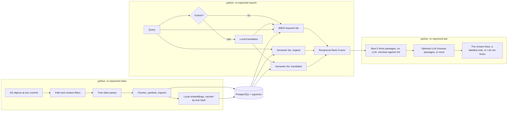

# Architecture

RepoMind is so far a retrieval and answering engine with a command line interface. There is deliberately no web application, user management, GitHub API integration or job queue yet: those come only after the core is shown to find the right code and explain it correctly.

## Reading source code

`repomind/ingest/git_source.py` reads only from Git's object database (`rev-parse`, `ls-tree`, `cat-file`). This one decision settles several requirements:

| Requirement | How reading Git objects meets it |
| --- | --- |
| Citations must match a commit | Content is, by definition, the content of that SHA |
| Do not modify analyzed projects | Plumbing commands run with `GIT_OPTIONAL_LOCKS=0`; a test compares `.git` file timestamps before and after |
| Never run analyzed code | Only `cat-file` output reaches the parser; hooks and filters are not involved, and `core.fsmonitor` is forced off |
| Keep uncommitted secrets out | `.env` files in the working tree are unreachable, and uncommitted edits are ignored |
| No copies of other projects | No snapshot folder is needed |

A `.env` that *was* committed is still reachable through Git, so the filters below apply as well.

## Filtering

`repomind/ingest/filters.py` runs path rules before any content is read:

- any path segment starting with `.` (`.env`, `.git`, `.github`, hidden files);
- dependency and build folders: `node_modules`, `target`, `dist`, `build`, `vendor`, `out`, `coverage` and similar;
- files whose name starts with the word `secret`, `secrets`, `credential`, `credentials` or `creds` (so `secrets.ts`, but not `SecretRotationService.java`), or that carry an `.env.` segment (`prod.env.js`);
- generated files (`*.d.ts`, `*.min.js`, bundles), files over 1 MB, and unsupported languages.

Content rules then reject binary files, non-UTF-8 files, minified code, and files matching high-confidence credential patterns (private keys and AWS, GitHub, OpenAI, Anthropic, Google and Slack tokens). The report names such a file but never its secret. This scan does not catch generic values such as `password = "..."` in code; see [limitations](#known-limitations).

Two more file types need rules of their own:

- **YAML** files with a personal or secret marker in the name (`application-local.yml`, `*-override.yml`, `vault.yml`, `kubeconfig.yml`) and lock files are skipped. In the rest, a chunk holding a literal credential, such as a password key or a URL with a password, is withheld on its own and reported, so that one development password does not hide a whole compose file.
- **SQL** files with a literal `PASSWORD '...'` or `IDENTIFIED BY '...'` are rejected.

## Parsing and chunking

`repomind/parsing/chunker.py` uses Tree-sitter grammars for Java, TypeScript, TSX and JavaScript. Source is parsed, never evaluated.

`repomind/parsing/structured.py` handles the other two. SQL is split into statements by a small lexer that understands comments, strings and dollar quoting. YAML goes through Tree-sitter, which yields syntax nodes only, so a tag such as `!!python/object` stays plain text, unlike with a loader that constructs objects. Neither is ever executed.

| Situation | Result |
| --- | --- |
| Class of up to 40 lines | One chunk |
| Larger class | A header chunk (doc comment, annotations, leading fields) plus member chunks |
| Adjacent members of up to 3 lines, such as getters | One grouped chunk |
| Comment or decorator directly above a declaration | Stays with the declaration |
| Callable over 60 lines or 1500 characters | Split at statement boundaries; a statement that does not fit is split inside its block; raw lines are the last resort |
| Non-declaration top-level code | Merged into `module` chunks |
| `import` statements | Stored as structured rows, not retrievable chunks: they carry no behaviour, yet would rank highly for any query naming a library |

**Line references are exact by construction.** A chunk's `content` is always the lines `start_line..end_line` joined by `\n`, and `\n` is the only line separator. `str.splitlines` is deliberately not used: it also breaks on form feeds and U+2028, which would silently shift every later line number away from what Tree-sitter and Git report.

The parts of a split function stay contiguous and cover it completely. Later parts do not contain the signature, so it is added to the embedded text.

## Storage

PostgreSQL 17 with pgvector runs in RepoMind's own Compose project, on `127.0.0.1:55432`. The schema is in `repomind/store/schema.sql`:

- `repositories`, `snapshots` (one per indexed commit), `files`, `chunks`, `symbols`, `imports`. A new commit replaces the previous snapshot in a single transaction, so a failure cannot leave a half-written index.
- `embeddings`, keyed by `(text_hash, model)` and independent of snapshots. Unchanged code is never embedded twice, across commits and repositories, and interrupted runs resume because each batch commits on its own.
- `llm_usage`, used to enforce the total budget.

Re-indexing the same commit with the same `PIPELINE_VERSION` does nothing.

Semantic search is an exact cosine scan. At about 1,200 chunks it is fast enough, and it keeps an approximate index from capping the measured recall.

## Retrieval

**Keyword** (`search/keyword.py`). BM25 (k1 = 1.2, b = 0.75) over a code-aware tokenizer. `cancelReservation` yields `cancel`, `reserv` and the whole identifier, so both natural language and exact symbol searches match. Names joined by a hyphen or underscore, such as `token-ttl`, are also kept whole, which makes them rare and so easy to find. Symbol names count three times and the file name 1.5 times. The index is built in memory per process, which is simple and fast at this size but will not scale to very large corpora.

**Semantic** (`search/engine.py`, `store/database.py`). Cosine similarity over `intfloat/multilingual-e5-small`: 384 dimensions, MIT licensed, run locally through ONNX with no API cost. Each chunk is embedded with its path and symbol as context. It was chosen on the dev split against `BAAI/bge-small-en-v1.5` and `jinaai/jina-embeddings-v2-base-code`: it was best for Turkish questions and on combined MRR, and it is the only candidate that understands Turkish without the translator. English-only results favoured `bge-small`, though with 11 dev questions the confidence intervals overlap. See [evaluation.md](evaluation.md#embedding-model-comparison).

**Hybrid** (`search/hybrid.py`). Reciprocal Rank Fusion with k = 10: `score(d) = Σ 1 / (10 + rank_list(d))`. It uses only ranks, so BM25 scores and cosine similarities never have to be made comparable, and `--explain` can show exactly why a result is where it is. The usual k = 60 rewards agreement, and the right chunk was often high in one list and lost to chunks in the middle of all of them.

**Test code is left out by default.** In the first measurement 55% of the top results for English questions were tests, because tests repeat the vocabulary of the code they exercise. They are included when a query mentions tests or when `--include-tests` is passed.

**Turkish queries** (`search/translation.py`). Code is in English, so a Turkish question shares few terms with it. A pinned local Opus-MT model (CTranslate2, CPU, about 0.1 s) adds an English version of the query. The translation is sometimes wrong, so it is added to the original rather than replacing it. If the model cannot load, search continues with a warning.

**Turkish software words** (`search/glossary.py`). A translator picks one sense of a word, and "yenileme anahtarı" came back as "update key". A small hand-written glossary keeps every sense, and only those the repository's code contains are used. `ask` gives the best chunks for those words seats after the others, up to 5. This needs no model, and reading the extra chunks adds about 0.3 seconds per question.

These ideas were tested and rejected, and their code removed:

- A per-file result cap made no measurable difference.
- Mapping unknown Turkish words to the nearest code vocabulary through embeddings produced useful pairs such as `Rezervasyon → reservation`, but also noise such as `Şifreler → reconciler`. Similarities sat in a narrow 0.83 to 0.91 band, so no threshold could separate the two.
- Cross-encoder reranking gave no clear gain across both question sets and took about 21 seconds per query with the only candidate worth considering. See [evaluation.md](evaluation.md#reranker).
- Symbol names, file paths, callers and callees as an extra ranked list made results worse or no better on the first question set, so they were never run on the second.
- A separate index of single lines, and one chunk per YAML key, each found some short lines and lost as many other questions. See [evaluation.md](evaluation.md#measured-and-left-out).

## Answering

`repomind/qa/` answers only through this sequence:

1. Translate a Turkish question to English with the same model. This wording is better than the local translator's, at about 2.5 seconds, so only `ask` uses it. `search` keeps working without any LLM.
2. Retrieve up to 12 chunks with hybrid search, and for a Turkish question up to 5 more through the glossary.
3. Refuse if the question is about something the code never mentions.
4. Narrow the chunks to at most 5 short passages with no LLM, and compare each with Git.
5. Refuse if no passage mentions enough of the question.
6. Without an LLM, stop and list the passages, labelled as not being an AI answer.
7. Enforce the budget, and send the passages to the model in one request.
8. Show the lines it chose, or say "I do not know".

### Real lines, not sentences

A source existing does not mean it supports a claim. Two earlier designs failed on this. Given 8 sources at once, the small model stitched them into plausible stories. Given one source per request and asked to quote its proof, it still wrote false sentences next to real quotes, and none of 26 answers was fully correct.

So the model no longer writes the answer. `repomind/qa/passages.py` cuts the retrieved chunks into 3-line windows, so that every line is in one, and ranks them by three lists through RRF with k = 30: shared terms, weighing rare ones more; the local embedding model; and the rank search gave the chunk, because a window cannot see what search weighed. The closest window in meaning is always shown, because only that list can see a synonym. Each window is embedded with its path and symbol, because 3 lines alone say little. Neighbouring windows merge up to 5 lines, no line is shown twice, a line left between two passages extends one of them, and one file can fill at most 3 of the 5 passages. This takes about a second and needs no LLM. All these settings were chosen on question sets that have been read.

Before that, search takes 12 chunks. A Turkish question is searched in the model's translation and in the local translator's, so that one wrong translation cannot decide alone, and file paths, symbol names and acronyms are kept through translation. Limits per chunk, removing near-duplicate windows, and adding path terms to the ranking were measured and left out, because they did not help. On a new question set these changes showed no clear gain over 8 chunks and one translation. See [evaluation.md](evaluation.md#fourth-question-set). The later work described above has not had that test.

The model then gets one request: which passages answer the question, at most two, or none? It replies with ids, and the lines shown come from the backend, so it cannot change a value, a file or a line number. It may add one sentence, which is shown apart and labelled "Model's reading, not verified".

### Refusing without a model

A model cannot be relied on to refuse. The first run answered 5 of 6 unanswerable questions by inventing something, such as a `schema.graphql` file that does not exist. In the pilot, `qwen2.5:3b` was asked 13 times to choose lines or none, and never chose none, even with an example of doing so in its prompt.

Retrieval similarity does not help: on the measured questions, unanswerable ones scored as high as answerable ones (cosine 0.82 to 0.87 against 0.80 to 0.89). Vocabulary does differ, so `repomind/qa/sufficiency.py` refuses before any model call when either of these holds:

- a name-like term (`Kafka`, `GraphQL`, `S3`) from the question occurs nowhere in the code;
- at least two ordinary words of an English question occur nowhere in the code.

Words of a translated question only produce a warning. A translation's wording says little about the code, and this rule refused 3 answerable Turkish questions while catching only 2 negatives. Questions refused this way cost nothing. The check cannot catch a question whose every word happens to appear in the code.

A second rule looks at the lines themselves: a passage counts as evidence only if it shares at least two terms with the question. One shared word is what nearby code looks like. On an earlier question set it took unanswerable questions refused from 3 of 10 to 7 of 10, while answers from gold fell from 15 to 13. It is a blunt rule. In the pilot it also refused one answerable question, and it let through two unanswerable ones whose words appear in nearby code.

Thresholds on similarity, or on the share of question terms, do not work: on the second question set, unanswerable questions scored as high as answerable ones.

### Verification

`repomind/qa/verification.py` and `QAEngine` check everything before it can reach the user:

- Each passage's lines are compared with the blob in Git at the indexed commit before the model sees them, so a tampered database row is never shown.
- A reply can only choose passages by the ids it was offered. Anything else in it is ignored, and a reply that chooses nothing offered counts as invalid.
- A note is left out, and the lines stay, if it names something that is in neither the chosen lines nor the question, gives a number they do not contain, drifts into a script that is in neither, or is too long to be one sentence.

**What this does not prove.** Verification shows that the lines exist at the commit, and that a note names nothing the lines do not contain. It does not show that the lines answer the question, or that a note made of real names is true. A citation alone does not prove an answer, and `ask` says so under every answer. See [limitations](#known-limitations).

### Prompt injection

Repository content is untrusted: a comment can address the model directly. The defences are layered:

1. Sources are wrapped in tags with a random per-request nonce, so code cannot close the data block.
2. Paths and symbols, which the repository also controls, are reduced to safe characters.
3. The system prompt declares the passages to be data.
4. The model has no tools, and it can only point at offered passages by id. An injection cannot add a line or a location to the answer. At worst it can change which lines are chosen, or distort a note that is already labelled as unverified.
5. A hostile comment is the repository's own text, so it can appear among the lines shown. It is displayed as code, never as the model's words.
6. Repository content and model output have terminal control characters removed before printing.

### Cost and data limits

| Limit | Default |
| --- | --- |
| Chunks taken from search per question | 12, and up to 5 more through the glossary |
| Passages offered per question | 5, of at most 5 lines |
| Estimated input tokens per request | 4000 |
| Output tokens per request | 250 |
| Total spend | $0 unless prices and a budget are set |

The budget check runs before each request, using worst-case cost. A non-loopback endpoint is refused unless `REPOMIND_LLM_ALLOW_REMOTE=1`, because it sends source code to a third party, and a remote endpoint with an API key is refused until prices are configured. If an endpoint reports far fewer input tokens than were sent, a warning says that it may have truncated the source.

All providers share one small OpenAI-compatible client using only the standard library. The default local setup is Ollama in a container from RepoMind's Compose file, with no account or API key.

### Memory limits

A run with the 7B model was once stopped because the machine ran critically low on memory, and everything it had answered was lost. Four things now guard against that:

| Measure | Why |
| --- | --- |
| `OLLAMA_MAX_LOADED_MODELS=1` | Two models loaded together were measured at 8.7 GiB |
| `OLLAMA_NUM_PARALLEL=1` | Ollama's default reserved twice the context (`--parallel 2 --ctx-size 16384`), although RepoMind sends one request at a time |
| `OLLAMA_KEEP_ALIVE=2m` and `mem_limit: 8g` | A model is released soon after use, and a model that does not fit fails inside its container |
| `gpus: all` | Layers that fit in VRAM leave physical RAM and run faster. Through WSL they still use Windows commit space, about as much as the model's size |
| `evaluate-ask` | Saves each question to a checkpoint as it finishes, does not start with less than 3 GB free, and stops between questions if free memory falls below that |

Free memory here means the smaller of free physical memory and free commit space, because Windows can run out of commit space while physical memory is still free. A checkpoint records the model, question set and prompts, and refuses to continue a run if any of them changed. The memory check runs between questions, so it cannot catch a spike during one, which is why [`resource_trial.ps1`](../eval/tools/resource_trial.ps1) asks for 12 GB before it loads a model.

## Known limitations

- **A verified line is not a proven answer.** The lines are real, and choosing them is still a judgement. In the pilot, the model chose lines that do not touch the gold span for 7 of 12 Turkish questions. See [evaluation.md](evaluation.md#pilot-answers-made-of-real-lines).
- **The right lines often never reach the model.** On the fourth question set, when it was measured, search missed them for 5 of 16 Turkish questions, and passage selection for 4 more. After later work on questions already read, they still miss 17 of 85. A short line that a question describes without naming, such as `token-ttl`, is still hard to find.
- **The evidence rule drops some right answers.** It asks for 2 words shared with the question, which a short line often does not have. For 12 of 85 questions it would drop the right lines if the model chose them.
- **The refusal rules look at words, not meaning.** They miss questions whose words appear in nearby code. Features next to existing code are the hard case: "how are notes in the trash restored?" passes because notes and deletion both exist. They also refuse some answerable questions.
- **Declining depends on the model.** `qwen2.5:3b` never chose "none" in the pilot, in 13 requests. `qwen2.5:7b` did so in 5 of 16, every time the right lines were absent.
- **Recall@5 is good on the second set and moderate on the first**, 0.67 to 0.83 against 0.50 to 0.58. See [evaluation.md](evaluation.md).
- **Turkish depends on an imperfect translator**, and detection relies on Turkish letters or common function words, so a bare `stok rezervasyon` is not translated.
- **Adding SQL and YAML cost some Turkish ranking on code questions**, because the new chunks compete with code.
- **2.4% of the code chunks exceed the model's 512-token window** (26 of 1,106, longest 623). Their tails are not embedded, although keyword search still covers them.
- **Secret detection is pattern based.** It catches known token formats and literal credential keys, not every hardcoded password.
- **Only the latest indexed commit is kept per repository.**
- **The keyword index is rebuilt in memory per process.**
- **The evaluation has 85 answerable questions on two repositories**, labelled and graded by one reviewer, so intervals are wide and results may not generalize.
