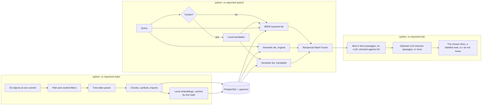

# Architecture

RepoMind is a retrieval and answering engine, with a command line and a [local web application](#web-application) over it. Both call the same code, and the web layer adds no search or answer logic. There are deliberately no accounts or separate job services: it is for one person on one machine.



## Reading source code

`repomind/ingest/git_source.py` reads only from Git's object database (`rev-parse`, `ls-tree`, `cat-file`). This one decision settles several requirements:

| Requirement | How reading Git objects meets it |
| --- | --- |
| Citations must match a commit | Content is, by definition, the content of that SHA |
| Do not modify analyzed projects | Plumbing commands run with `GIT_OPTIONAL_LOCKS=0`; a test compares `.git` file timestamps before and after |
| Never run analyzed code | Only `cat-file` output reaches the parser; hooks and filters are not involved, and `core.fsmonitor` is forced off |
| Keep uncommitted secrets out | `.env` files in the working tree are unreachable, and uncommitted edits are ignored |
| No copies of other projects | No snapshot folder is needed |

A `.env` that *was* committed is still reachable through Git, so the filters below apply as well.

## Filtering

`repomind/ingest/filters.py` runs path rules before any content is read:

- any path segment starting with `.` (`.env`, `.git`, `.github`, hidden files);
- dependency and build folders: `node_modules`, `target`, `dist`, `build`, `vendor`, `out`, `coverage` and similar;
- files whose name starts with the word `secret`, `secrets`, `credential`, `credentials` or `creds` (so `secrets.ts`, but not `SecretRotationService.java`), or that carry an `.env.` segment (`prod.env.js`);
- generated files (`*.d.ts`, `*.min.js`, bundles), files over 1 MB, and unsupported languages.

Content rules then reject binary files, non-UTF-8 files, minified code, and files matching high-confidence credential patterns (private keys and AWS, GitHub, OpenAI, Anthropic, Google and Slack tokens). The report names such a file but never its secret.

Every language then has rules of its own for a credential that is not in a known format:

- **Code** (Java, JavaScript, TypeScript, TSX): a statement in which a credential-named variable, property or setter is given a quoted literal, such as `JWT_SECRET = "..."`, `password: "..."` or `setApiKey("...")`, is left out of the chunk around it, and the rest of the chunk stays. The name has to hold a word such as password, secret, token or api key, and not end in a word that says it only describes one, such as header, prefix, name or length. A value from elsewhere (`process.env.X`, a call, a placeholder) is not a literal, and a literal with spaces is taken for prose. A URL with a password in it is left out in any language. Tree-sitter widens the place to the whole statement, so the second half of a value written over two lines goes too. See [limitations](#known-limitations) for what this cannot see.

- **YAML** files with a personal or secret marker in the name (`application-local.yml`, `*-override.yml`, `vault.yml`, `kubeconfig.yml`) and lock files are skipped. In the rest, a chunk holding a literal credential, such as a password key or a URL with a password, is withheld on its own and reported, so that one development password does not hide a whole compose file. An entry holding one is taken apart down to the flat list of settings that holds it, such as a service's `environment`, which is withheld whole, so the same service's `build` and `depends_on` stay searchable.
- **SQL** files with a literal `PASSWORD '...'` or `IDENTIFIED BY '...'` are rejected.

The same rules run again when something is asked, because an index made by an older version may still hold such lines. Search leaves out any chunk that holds a credential, so no result, passage or prompt starts from one. Before lines are checked against Git and offered to a model, each passage is checked once more, which also covers a declaration that [completion](#a-constants-declaration) fetched. The file view hides the same statements in every language.

## Parsing and chunking

`repomind/parsing/chunker.py` uses Tree-sitter grammars for Java, TypeScript, TSX and JavaScript. Source is parsed, never evaluated.

`repomind/parsing/structured.py` handles the other two. SQL is split into statements by a small lexer that understands comments, strings and dollar quoting. YAML goes through Tree-sitter, which yields syntax nodes only, so a tag such as `!!python/object` stays plain text, unlike with a loader that constructs objects. Neither is ever executed.

| Situation | Result |
| --- | --- |
| Class of up to 40 lines | One chunk |
| Larger class | A header chunk (doc comment, annotations, leading fields) plus member chunks |
| Adjacent members of up to 3 lines, such as getters | One grouped chunk |
| Comment or decorator directly above a declaration | Stays with the declaration |
| Callable over 60 lines or 1500 characters | Split at statement boundaries; a statement that does not fit is split inside its block; raw lines are the last resort |
| Non-declaration top-level code | Merged into `module` chunks |
| `import` statements | Stored as structured rows, not retrievable chunks: they carry no behaviour, yet would rank highly for any query naming a library |

**Line references are exact by construction.** A chunk's `content` is always the lines `start_line..end_line` joined by `\n`, and `\n` is the only line separator. `str.splitlines` is deliberately not used: it also breaks on form feeds and U+2028, which would silently shift every later line number away from what Tree-sitter and Git report.

The parts of a split function stay contiguous and cover it completely. Later parts do not contain the signature, so it is added to the embedded text.

## Storage

PostgreSQL 17 with pgvector runs in RepoMind's own Compose project, on `127.0.0.1:55432`. The schema is in `repomind/store/schema.sql`:

- `repositories`, `snapshots` (one per indexed commit), `files`, `chunks`, `symbols`, `imports`. A new commit replaces the previous snapshot in a single transaction, so a failure cannot leave a half-written index.
- `embeddings`, keyed by `(text_hash, model)` and independent of snapshots. Unchanged code is never embedded twice, across commits and repositories, and interrupted runs resume because each batch commits on its own.
- `llm_usage`, used to enforce the total budget.

Re-indexing the same commit with the same `PIPELINE_VERSION` does nothing.

### The index version

`PIPELINE_VERSION` in `repomind/__init__.py` is the version of what indexing stores for a commit: which lines become chunks, symbols and imports, and which are withheld. Each snapshot records the version that made it.

- **When it changes.** Whenever a change to parsing, chunking or withholding gives any file different output. `tests/test_pipeline_version.py` parses fixed files in every indexed language and compares a fingerprint of the result with the one recorded for the current version, so such a change fails the tests until the version is bumped and the new fingerprint recorded. It is 3 now. Version 2 is the first published one, and by mistake it also covers a later change to YAML chunking.
- **What an upgrade asks for.** Run `python -m repomind index --path <repository>` again for each indexed repository. With a newer version the same commit is read and parsed again, with no `--force`, and vectors are kept for chunks whose text did not change. Nothing is re-indexed by itself. A repository added by URL is indexed again when it is added again.
- **Until then.** The older index keeps working. `python -m repomind repos` marks it as outdated, and every search and question on it carries a warning. Its chunks are the older ones, so results can differ from a fresh index. Lines that are now withheld may still be stored in it, and are not shown: search leaves out any chunk holding a credential, whatever version stored it.

Semantic search is an exact cosine scan. At about 1,200 chunks it is fast enough, and it keeps an approximate index from capping the measured recall.

## Retrieval

**Keyword** (`search/keyword.py`). BM25 (k1 = 1.2, b = 0.75) over a code-aware tokenizer. `cancelReservation` yields `cancel`, `reserv` and the whole identifier, so both natural language and exact symbol searches match. Names joined by a hyphen or underscore, such as `token-ttl`, are also kept whole, which makes them rare and so easy to find. Symbol names count three times and the file name 1.5 times. The index is built in memory per process, which is simple and fast at this size but will not scale to very large corpora.

**Semantic** (`search/engine.py`, `store/database.py`). Cosine similarity over `intfloat/multilingual-e5-small`: 384 dimensions, MIT licensed, run locally through ONNX with no API cost. Each chunk is embedded with its path and symbol as context. It was chosen on the dev split against `BAAI/bge-small-en-v1.5` and `jinaai/jina-embeddings-v2-base-code`: it was best for Turkish questions and on combined MRR, and it is the only candidate that understands Turkish without the translator. English-only results favoured `bge-small`, though with 11 dev questions the confidence intervals overlap. See [evaluation.md](evaluation.md#embedding-model-comparison).

**Hybrid** (`search/hybrid.py`). Reciprocal Rank Fusion with k = 10: `score(d) = Σ 1 / (10 + rank_list(d))`. It uses only ranks, so BM25 scores and cosine similarities never have to be made comparable, and `--explain` can show exactly why a result is where it is. The usual k = 60 rewards agreement, and the right chunk was often high in one list and lost to chunks in the middle of all of them.

**Test code is left out by default.** In the first measurement 55% of the top results for English questions were tests, because tests repeat the vocabulary of the code they exercise. They are included when a query mentions tests or when `--include-tests` is passed.

**Turkish queries** (`search/translation.py`). Code is in English, so a Turkish question shares few terms with it. A pinned local Opus-MT model (CTranslate2, CPU, about 0.1 s) adds an English version of the query. The translation is sometimes wrong, so it is added to the original rather than replacing it. If the model cannot load, search continues with a warning.

**Turkish software words** (`search/glossary.py`). A translator picks one sense of a word, and "yenileme anahtarı" came back as "update key". A small hand-written glossary keeps every sense, and only those the repository's code contains are used. `ask` gives the best chunks for those words seats after the others, up to 5. This needs no model.

These ideas were tested and rejected, and their code removed:

- A per-file result cap made no measurable difference.
- Mapping unknown Turkish words to the nearest code vocabulary through embeddings produced useful pairs such as `Rezervasyon → reservation`, but also noise such as `Şifreler → reconciler`. Similarities sat in a narrow 0.83 to 0.91 band, so no threshold could separate the two.
- Cross-encoder reranking gave no clear gain across both question sets and took about 21 seconds per query with the only candidate worth considering. See [evaluation.md](evaluation.md#reranker).
- Symbol names, file paths, callers and callees as an extra ranked list made results worse or no better on the first question set, so they were never run on the second.
- A separate index of single lines, and one chunk per YAML key, each found some short lines and lost as many other questions. See [evaluation.md](evaluation.md#measured-and-left-out).
- Giving the glossary's terms to the model's translation prompt improved the wording but not what search found. More unanswerable questions got past the evidence rule, and some replies repeated the instruction instead of translating. See [evaluation.md](evaluation.md#the-full-translation-comparison).

## Answering

`repomind/qa/` answers only through this sequence:

1. Translate a Turkish question to English with the same model. This wording is better than the local translator's, at about 2.5 seconds, so only `ask` uses it. `search` keeps working without any LLM.
2. Retrieve up to 12 chunks with hybrid search, and for a Turkish question up to 5 more through the glossary.
3. Refuse if the question is about something the code never mentions.
4. Narrow the chunks to at most 5 short passages with no LLM, add the declaration of a constant they use when it can be found for certain, and compare each with Git.
5. Refuse if no passage mentions enough of the question.
6. Without an LLM, stop and list the passages, labelled as not being an AI answer.
7. Enforce the budget, and send the passages to the model in one request.
8. Show the lines it chose, or say "I do not know". Lines it chose that the evidence rule turned down are shown apart, as a source to review.

### Two checks that must not be confused

Each source in `AskResult.sources()` carries both of them:

- **`exists_in_git`.** These are the lines the file holds at the indexed commit. Nothing that fails this is ever shown or offered to the model.
- **`answer_check`.** Whether the lines were checked against the question: `passed` means the model chose them and they passed the evidence rule, `failed` means the model chose them and they did not, and `not_made` means they are the closest lines and nothing judged them.

The first does not imply the second, and `passed` is a check, not a proof. In [a trial](evaluation.md#two-short-trials), all 15 lines 7B chose were real, and 7 of them answered the question.

**A source to review** (`AskResult.review_candidates`, "İncelenebilecek kaynak adayı" for a Turkish question) is a choice the rule turned down. The reader gets its path, lines and code, and is told that nothing confirms it answers the question. It does not change the status, the answer or the citations, so "I do not know" stays "I do not know", and the model's note about it is never shown. There can be none when the rule refuses before the model is asked. The closest lines are listed then, as before.

### A constant's declaration

A passage that reads `.timeout(REQUEST_TIMEOUT)` does not say how long the timeout is. `repomind/qa/completion.py` adds at most two declarations of constants the passages use, read from Git at the indexed commit and found with Tree-sitter. A declaration is added only when it lies inside an indexed chunk, holds no credential and is at most 4 lines long. It is offered to the model like any other passage.

**The value is shown with the line that names it.** A question about a value needs two places, the line that uses the constant and the line that gives it its value, and the model usually chooses the first. So when chosen lines pass the evidence rule and use a constant whose declaration was offered, the declaration is shown with them: `AskResult.declared_values`, the role `declaration` in the API, a heading of its own on the page. It is marked as added by RepoMind, and not as the model's choice. This goes one way only. Chosen lines bring the declaration of what they name, and a chosen declaration brings nothing: that is linked evidence, below.

**A declaration the rule turned down is shown with the line that uses it, to review.** The model sometimes chooses only the declaration: asked how many books a member may borrow at once, it chose `MAX_ACTIVE_LOANS = 3`. That line shares no word with the question, so it is turned down, and the verdict stays "not enough evidence". Such a declaration is then shown under **Source to review**, together with the lines that use it (`review_uses`, role `review_use`), so that the reader sees the value and where it is enforced.

The use is taken only when four things hold:
- completion resolved the constant in it to exactly this declaration;
- it was offered to the model, so it passed the credential and Git checks;
- it is from the same commit;
- it passes the evidence rule on its own.

A chosen passage counts as a declaration only if it is no longer than four lines. At most two uses are added, and nothing is shown twice. The use is marked as added by RepoMind, and it is never an answer: accepting a declaration through a line that uses it was measured on 342 questions with no model, and about two in three such acceptances were a wrong place or an unanswerable question.

Which declaration a name means is decided where it is used, by `repomind/qa/declarations.py`, from the syntax tree alone. The same name is often declared twice in one repository, so a declaration found anywhere else is not an answer:

- **TypeScript and JavaScript** follow lexical scope: the nearest `const`, `let` or `var` around the use, or a name the file imports from a relative module, followed to the top level of that file. A parameter, a destructured name, a loop or catch variable, a function, a class or an enum of that name hides everything outside it, and is not followed. `Class.NAME` is followed to a static field of a class the same file declares.
- **Java** follows the language's own order. A plain name means a local variable declared earlier in an enclosing block, then a field an enclosing type declares itself, then a single static import. `Type.NAME` looks for `Type` in the types around the use, the file's top-level types, a single-type import, the file's own package and last the on-demand imports. An import of a type that is not in the repository ends the search, so a library's `Limits` is never taken for the repository's own.

Anything else is refused: a field that may be inherited, `package.Type.NAME`, `variable.NAME`, `this.NAME` in TypeScript, re-exports, default and namespace imports, path aliases, two declarations in one scope, two files declaring the same type, and lines where the name means two things. On StockGuard and SyncNotes at their indexed commits, this finds the same declaration as the file-wide search it replaced in all 148 cases where that search found one.

**Linked evidence is experimental, and off.** With `REPOMIND_LLM_LINKED_EVIDENCE=1`, a declaration the model chose that fails the evidence rule is still shown as an answer when the line that uses it was offered and passes the rule, and the declaration shares one word with the question. The use is then shown too, marked as added by RepoMind and not chosen by the model: `AskResult.linked_uses` holds it, the API gives it the role `linked_use` instead of `answer`, the page lists it under a heading of its own, and the command line prints it apart. It is off by default because the link shows that one line refers to the other, and not that either answers the question. The one shared word usually comes from the constant's own name, and on the two test repositories 1 of 15 declarations it could accept was a right source. See [EVIDENCE_COMPLETION.md](../eval/EVIDENCE_COMPLETION.md) for the record made while it was always on.

### Real lines, not sentences

A source existing does not mean it supports a claim. Two earlier designs failed on this. Given 8 sources at once, the small model stitched them into plausible stories. Given one source per request and asked to quote its proof, it still wrote false sentences next to real quotes, and none of 26 answers was fully correct.

So the model no longer writes the answer. `repomind/qa/passages.py` cuts the retrieved chunks into 3-line windows, so that every line is in one, and ranks them by three lists through RRF with k = 30: shared terms, weighing rare ones more; the local embedding model; and the rank search gave the chunk, because a window cannot see what search weighed. The closest window in meaning is always shown, because only that list can see a synonym. Each window is embedded with its path and symbol, because 3 lines alone say little. Neighbouring windows merge up to 5 lines, no line is shown twice, a line left between two passages extends one of them, and one file can fill at most 3 of the 5 passages. This takes about a second and needs no LLM. All these settings were chosen on question sets that have been read.

Before that, search takes 12 chunks. A Turkish question is searched in the model's translation and in the local translator's, so that one wrong translation cannot decide alone, and file paths, symbol names and acronyms are kept through translation. Limits per chunk, removing near-duplicate windows, and adding path terms to the ranking were measured and left out, because they did not help. On a new question set these changes showed no clear gain over 8 chunks and one translation. See [evaluation.md](evaluation.md#fourth-question-set). The later work described above has not had that test.

The model then gets one request: which passages answer the question, at most two, or none? It replies with ids, and the lines shown come from the backend, so it cannot change a value, a file or a line number. It may add one sentence, which is shown apart and labelled "Model's reading, not verified".

### Refusing without a model

A model cannot be relied on to refuse. The first run answered 5 of 6 unanswerable questions by inventing something, such as a `schema.graphql` file that does not exist. In the pilot, `qwen2.5:3b` was asked 13 times to choose lines or none, and never chose none, even with an example of doing so in its prompt.

Retrieval similarity does not help: on the measured questions, unanswerable ones scored as high as answerable ones (cosine 0.82 to 0.87 against 0.80 to 0.89). Vocabulary does differ, so `repomind/qa/sufficiency.py` refuses before any model call when either of these holds:

- a name-like term (`Kafka`, `GraphQL`, `S3`) from the question occurs nowhere in the code;
- at least two ordinary words of an English question occur nowhere in the code.

A word counts as occurring when the code writes another word of its family: "exposed" where the code says `exposure`, "shown" for `show`, "creation" for `created`. One has to be the start of the other, four letters or more, and what is left an ending English builds such words with, so "comment" is not known because the code says `commit`. A number such as "95th" is neither a name nor a word. On the sixth question set, the check without these refused three answerable English questions for "95th", for "exposed, shown" and for "supports, creation".

Words of a translated question only produce a warning. A translation's wording says little about the code, and this rule refused 3 answerable Turkish questions while catching only 2 negatives. Questions refused this way cost nothing. The check cannot catch a question whose every word happens to appear in the code.

A second rule looks at the lines themselves: a passage counts as evidence only if it shares at least two terms with the question. The terms of a passage are those of its lines, of its file's name and of the unit it belongs to: three lines inside `StockMovement` are about stock movements whether or not they say so. Folder names are left out. A Turkish question is compared through the model's translation and through the local translator's, each on its own, and passing either is enough. A translation that changes the subject then no longer turns down the right lines, and the words of a wrong wording are never added to those of a right one. One shared word is what nearby code looks like. On an earlier question set it took unanswerable questions refused from 3 of 10 to 7 of 10, while answers from gold fell from 15 to 13. It is a blunt rule. In the pilot it also refused one answerable question, and it let through two unanswerable ones whose words appear in nearby code.

Thresholds on similarity, or on the share of question terms, do not work: on the second question set, unanswerable questions scored as high as answerable ones.

### A question that names its repository

Asked inside one repository, people often name it: "How does StockGuard prevent negative stock?" That says nothing about where to look, and it did harm. Search favoured whatever was named after the project, and those lines passed the evidence rule on the project's name alone. `repomind/qa/project_name.py` handles this, for any repository, when `ask` is given exactly one. It knows no repository's name and no word list.

| The name in the question | What happens |
| --- | --- |
| Stands alone: `StockGuard`, `StockGuard'ın`, `in StockGuard` | It leaves the search and the ranking of lines |
| Inside an identifier, key, path or quotes: `StockGuardProperties`, `stockguard.security`, `STOCKGUARD_JWT_SECRET`, `` `stockguard` `` | Nothing changes, because that is the topic |
| Fewer than 2 words would be left: "What is StockGuard?" | Nothing changes |

Three things keep the name from being lost, or from weakening anything:

- **One seat.** The best passage found by the question as asked, whose own lines name the project, such as `name: stockguard`, takes the last place. `import com.stockguard.x` does not count as naming it.
- **Evidence.** Such lines count the name as one shared word, and still need another. They must also pass the evidence rule for the question as asked, so this can never accept lines that the rule would have turned down with the name in the search.
- **Refusal.** The check for what the code never mentions always reads the question as asked. Without the name in front, a word such as `Kafka` would be first in the sentence, and would no longer look like a proper noun.

The model still reads the whole question, and the passages stay in their ranked order, with the seat last. The code search tab is not affected: what people type there is searched as typed.

Measured with no model on the 147 stored questions, 101 answerable and 46 unanswerable, in Turkish / English. These questions had all been read, so this is development data and proves nothing independent. "Name added" means the repository's name was added mechanically to each stored question, with no new questions or labels. The scripts were for this one comparison and are not kept.

| | Right code in candidates | In the passages | Passing the evidence rule | Unanswerable reaching the model |
| --- | --- | --- | --- | --- |
| As stored | 90 / 90 | 78 / 71 | 65 / 67 | 19 / 19 |
| Name added, before this rule | 80 / 85 | 64 / 64 | 58 / 59 | 34 / 23 |
| Name added, with this rule | 89 / 89 | 76 / 72 | 65 / 66 | 23 / 20 |

- **As stored,** 145 of the 147 questions got the same passages and the same outcome as before. The other 2 did not have the right lines in their passages either way.
- **Against before, with the name added,** the right lines reached the passages for 14 more questions and 2 fewer in Turkish (`sn-viewer-readonly`, `v4-sg-db-port` lost), and for 10 more and 2 fewer in English (`sn-redis-outage`, `v3-sg-instance-header` lost). No unanswerable question newly reached the model, and 11 and 3 no longer do.
- **The price:** simply removing the name, with no seat, does a little better on these questions, with 80 / 73 in the passages and 19 / 19 unanswerable reaching the model. But it lost what was really being asked about in 8 of 26 checks, against 1 with this rule. A question naming the project also searches twice, which adds up to about half a second.

**What it still gets wrong.** There are 26 hand-written checks on questions really about the name, and these were run on the real code. The rule was corrected twice after looking at them, so they are not independent either.

- **One is worse than before:** "Which class holds the StockGuard configuration?" no longer reaches `StockGuardProperties` in English. This is left as it is, because another rule for it would only fit this example.
- **Two are no better than before:** asked for the compose project name of SyncNotes, the right line `name: syncnotes` is offered, and it cannot pass the evidence rule, with or without this change. In lower case the name stems differently from `SyncNotes` in the question, so the two do not match. If the model chooses that line, it is shown as a source to review.

**Finding the source is not choosing it.** This fixes the first and not the second. On "StockGuard stok miktarının negatife düşmesini nasıl engelliyor?" and its English version, the database constraints in `V2__catalog_and_stock.sql:22-26` were not offered to the model before in Turkish, and now they always are. Asked 6 times each through `ask` with `qwen2.5:7b`, it still chose `SimulationService.java:196-200` 5 times in Turkish and all 6 times in English, and that code only detects negative counters after a run. The reason for the one different run was not found. The seat also leaves out `StockLevelRepository.java:52-56` on this question, and line 58 of that file, the condition that really prevents overselling, was outside those lines anyway.

**Passage order was compared and left alone.** On 20 stored questions whose right lines were offered, sorting passages by file and line instead of rank gave 3 more correct choices and 2 fewer wrong ones. On 6 questions with this rule, it turned 2 correct choices wrong. The two results disagree on samples too small to settle it, so the ranked order stays.

### Verification

`repomind/qa/verification.py` and `QAEngine` check everything before it can reach the user:

- Each passage's lines are compared with the blob in Git at the indexed commit before the model sees them, so a tampered database row is never shown.
- A reply can only choose passages by the ids it was offered. Anything else in it is ignored, and a reply that chooses nothing offered counts as invalid.
- A reply that cannot be used is neither an answer nor a refusal by the model. Only `{"chosen": []}` says that nothing was chosen. An empty reply, one cut off at the output limit, text that is not JSON, a reply with no list, and ids that were not offered each end as `invalid_response`, with no source, and with what was wrong in `AskResult.reply_problem` and in the API's `reply_problem`. The start of the reply is kept in `AskResult.invalid_reply` for looking into it, and is not shown. It is not asked again.
- An endpoint that reports 0 input tokens has reported no count: the size of the request is then estimated, so that it is still accounted for, and it is not taken for a truncated prompt.
- A note is left out, and the lines stay, if it names something that is in neither the chosen lines nor the question, gives a number they do not contain, drifts into a script that is in neither, or is too long to be one sentence.

**What this does not prove.** Verification shows that the lines exist at the commit, and that a note names nothing the lines do not contain. It does not show that the lines answer the question, or that a note made of real names is true. A citation alone does not prove an answer, and `ask` says so under every answer. See [limitations](#known-limitations).

### Prompt injection

Repository content is untrusted: a comment can address the model directly. The defences are layered:

1. Sources are wrapped in tags with a random per-request nonce, so code cannot close the data block.
2. Paths and symbols, which the repository also controls, are reduced to safe characters.
3. The system prompt declares the passages to be data.
4. The model has no tools, and it can only point at offered passages by id. An injection cannot add a line or a location to the answer. At worst it can change which lines are chosen, or distort a note that is already labelled as unverified.
5. A hostile comment is the repository's own text, so it can appear among the lines shown. It is displayed as code, never as the model's words.
6. Repository content and model output have terminal control characters removed before printing.

### Cost and data limits

| Limit | Default |
| --- | --- |
| Chunks taken from search per question | 12, and up to 5 more through the glossary |
| Passages offered per question | 5, of at most 5 lines |
| Estimated input tokens per request | 4000 |
| Output tokens per request | 250 |
| Total spend | $0 unless prices and a budget are set |

The budget check runs before each request, using worst-case cost. A request that failed after it may have reached the model is recorded at the most it could cost, and marked so (see [the OpenAI API](#the-openai-api)). A non-loopback endpoint is refused unless `REPOMIND_LLM_ALLOW_REMOTE=1`, because it sends source code to a third party, and a remote endpoint with an API key is refused until prices are configured. If an endpoint reports far fewer input tokens than were sent, a warning says that it may have truncated the source.

All providers share one small OpenAI-compatible client using only the standard library. The default local setup is Ollama in a container from RepoMind's Compose file, with no account or API key.

### A model on another machine

The same client talks to any OpenAI-compatible server, and to Ollama on another machine through its `/v1` address, so a larger model needs settings and no code: `REPOMIND_LLM_BASE_URL`, `REPOMIND_LLM_MODEL`, `REPOMIND_LLM_API_KEY`, `REPOMIND_LLM_ALLOW_REMOTE=1`, and `REPOMIND_LLM_TIMEOUT_SECONDS` for a slow one. `.env.example` has them as one block, and going back to the local model is restoring two lines.

- **Code leaves the machine.** Each question and the passages chosen for it are sent to that server. It is refused until `REPOMIND_LLM_ALLOW_REMOTE=1` says this is meant. While a remote model is in use, the status in the top bar says "remote", the AI panel names the host, and `/api/health` reports `remote` and `endpoint`.
- **The key** is read from `.env`, which Git ignores, sent only in the `Authorization` header to that server, and never returned by the API.
- **Memory.** The rule that keeps the local model from starting on low memory looks at this machine, so it does not apply to a remote model.
- **What stays the same.** Search, passage selection, the credential checks, the refusal rules and the check against Git all run here, before anything is sent. Passages holding a credential are not sent to a remote model either.

On the 35 prompts of the sixth question set that reached the model, a run made outside this repository gave, for 27 answerable questions, 14 fully right with `qwen2.5:7b`, 17 with `qwen2.5-coder:14b` and 16 with `qwen2.5-coder:32b`, at a median of about 23 and 51 seconds for the larger two. That is the choice among the same passages, not the application end to end, and the models differ in more than size. It is why 14B is the model to try remotely, and not a result recorded here.

### The OpenAI API

`REPOMIND_LLM_PROVIDER=openai` uses the OpenAI API through the same client. The default, `ollama`, is what RepoMind always did, and its request has not changed.

**Settings.** [`repomind/qa/llm.py`](../repomind/qa/llm.py) refuses an OpenAI setup unless it has all of these:
- a model;
- a key, read only from `REPOMIND_LLM_API_KEY`;
- consent to send code, `REPOMIND_LLM_ALLOW_REMOTE=1`;
- both prices above 0;
- a budget above 0.

The address is fixed at `https://api.openai.com/v1`, and a configuration pointing elsewhere cannot even be made, so the key cannot be sent to another server. The OpenAI address used with the `ollama` provider is refused too, because that would skip the price and budget rules.

The key is left out of the configuration's `repr`. An error repeats a setting's value only when it is short and plain, so a key pasted into the wrong setting is not printed. A setup that is wrong does not stop search: the status is `misconfigured` and names the setting.

**The request.** A request to the Chat Completions endpoint sends:
- `max_completion_tokens`, which also counts a reasoning model's thinking, so it caps what one request can cost;
- `response_format` `json_object`;
- `store: false`, which asks OpenAI not to keep the exchange for its distillation and evaluation products, and is not a promise that nothing is kept;
- either `temperature` 0, or `reasoning_effort` and no temperature when `REPOMIND_LLM_REASONING_EFFORT` is set.

Redirects are not followed. For any other server, the key goes in a header that a redirect would not carry.

**Errors.** Each failure is an `LLMRequestError` with a kind. The message never holds the server's text or the key. It names the HTTP status, the parameter and code when they are plain identifiers, and the request ID.

| What OpenAI answered | Kind | State | Sent again |
| --- | --- | --- | --- |
| 401, 403 | `auth`, `forbidden` | `auth_failed` | no |
| 404 | `not_found` | `model_missing` | no |
| 429 naming a quota, credit, billing, spending or usage limit | `quota` | `limited` | no |
| other 429 | `rate_limit` | `limited` | once, after a `Retry-After` of 10 seconds or less |
| 503 | `server` | `offline` | once, after a `Retry-After` of 10 seconds or less |
| 500, 502, 504, a timeout, a lost connection | `server`, `timeout`, `connection` | `offline` | no, since it may have been processed |
| other 4xx, a redirect, an answer that cannot be read | `bad_request`, `redirect`, `bad_response` | `rejected` | no |

**The status.** The status asks OpenAI about the model with `GET /v1/models/<model>`. That request generates nothing, sends no question or code, and costs nothing. It is asked at most once a minute. After a refused key, a quota or a refused request, OpenAI is not asked again for a minute; after trouble that passes by itself, after 15 seconds. The memory rule applies only to a model on this machine. Whatever stops OpenAI, a question is still answered with the lines search finds, and says why.

**Prices.** OpenAI caches the start of a long prompt by itself, 1,024 tokens or more, for 30 minutes in Chat Completions. It bills each input token at one of three rates: uncached, read from the cache, or written to it. A cache write is billed instead of the uncached rate, not on top of it.

So `usage_cost` in [`repomind/qa/llm.py`](../repomind/qa/llm.py) takes `usage.prompt_tokens_details.cached_tokens` and `cache_write_tokens` out of `prompt_tokens`, and prices each part at its own rate:
- `REPOMIND_LLM_INPUT_USD_PER_MTOK`;
- `REPOMIND_LLM_CACHED_INPUT_USD_PER_MTOK`, optional, which counts reads at the input rate when unset;
- `REPOMIND_LLM_CACHE_WRITE_USD_PER_MTOK`, required for OpenAI.

A part the reply does not break down, or parts that add up to more than the whole, are counted at the highest input rate. The answer then says its cost is at most that, and its row is recorded as `estimated`. On the first real request, 1,050 input tokens, 1,047 of them written to the cache, and 45 output tokens came to $0.000153675 at gpt-6-luna's prices. The earlier count, before cache writes were priced, recorded $0.000128 for it. That row was left as it was.

**The budget.** Before every request, and every time the status is read, RepoMind adds up what it has recorded. The largest request it allows for counts every input token at the highest of the three input rates. The state is `budget_reached` once the largest request a question can make no longer fits in what is left, and then nothing is sent. Each `llm_usage` row has a kind:
- `reported`: the server's token counts;
- `estimated`: an answer without counts;
- `worst_case`: a request that failed after it may have reached the model, after a timeout, a lost connection, a server error other than 503, or an unreadable answer, counted at the most it could cost;
- `legacy`: from before kinds were kept.

Requests turned away with a 4xx, 429 or 503, a refused connection and an unknown host are not counted. Nothing in OpenAI's documentation says whether either kind of failure is charged.

The budget is not an exact ceiling. It is passed if:
- the prices set are wrong, a cache price included;
- the token estimate, three characters a token, is below the real count, by at most one request's error;
- the web page and the command line ask at the same moment;
- requests turned away are charged after all.

**The page.** It names the provider and where the model runs. For OpenAI it shows a note on what is sent, and the spending RepoMind has counted, with the cautious, estimated and legacy parts named apart, as its own count and not a bill. A model gets an accuracy figure only if it was measured in RepoMind. Today that is `qwen2.5:7b`, in `_MEASURED` in [`repomind/api/services.py`](../repomind/api/services.py).

**Before the first real request:** [docs/openai-first-run.md](openai-first-run.md) holds what the indexes store, how to check what would be sent, and the checklist.

### Tracing where the right lines are lost

For a developer. `python -m repomind ask "..." --repo name --expect "src/Order.java:10-20"` prints, for each expected place, the first stage it did not pass: not in the index, not among the chunks search returned, retrieved and not made a passage, refused before the model and by which rule, sent and not chosen, chosen and turned down by the evidence rule, or shown as an answer. `--expect` can be repeated for an answer that needs two places, with `|` between places that would do as well. Nothing is computed without it. [`repomind/qa/trace.py`](../repomind/qa/trace.py) does the same from an `AskResult`, and [`eval/tools/stage_trace.py`](../eval/tools/stage_trace.py) runs a whole question file with no model.

### Memory limits

A run with the 7B model was once stopped because the machine ran critically low on memory, and everything it had answered was lost. Four things now guard against that:

| Measure | Why |
| --- | --- |
| `OLLAMA_MAX_LOADED_MODELS=1` | Two models loaded together were measured at 8.7 GiB |
| `OLLAMA_NUM_PARALLEL=1` | Ollama's default reserved twice the context (`--parallel 2 --ctx-size 16384`), although RepoMind sends one request at a time |
| `OLLAMA_KEEP_ALIVE=2m` and `mem_limit: 8g` | A model is released soon after use, and a model that does not fit fails inside its container |
| `gpus: all`, in the optional `compose.gpu.yaml` | Layers that fit in VRAM leave physical RAM and run faster. Through WSL they still use Windows commit space, about as much as the model's size |
| `evaluate-ask` | Saves each question to a checkpoint as it finishes, does not start with less than 3 GB free, and stops between questions if free memory falls below that |
| The web application | Below 4 GB free, it does not call the model, and indexing does not start and stops at its next batch. One question runs at a time, and a second gets `429` |

Free memory here means the smaller of free physical memory and free commit space, because Windows can run out of commit space while physical memory is still free. A checkpoint records the model, question set and prompts, and refuses to continue a run if any of them changed. The memory check runs between questions, so it cannot catch a spike during one, which is why [`resource_trial.ps1`](../eval/tools/resource_trial.ps1) asks for 12 GB before it loads a model.

## Web application

`repomind/api` is a thin FastAPI layer over the same `SearchEngine`, `QAEngine` and `index_repository` that the command line uses. `web/` is a React and TypeScript client, whose types are generated from the API's OpenAPI document, and a test fails if the two drift apart. `python -m repomind serve` runs both in one process.

Routes are synchronous and run in FastAPI's thread pool, because the engine is. Each request has its own `Store`, and they share the embedder, translator, LLM client and keyword index cache. The model's state is checked at most every 5 seconds, and the OpenAI API's once a minute. If it is off, or dies during a question, a question still returns the closest lines and says the model was not used.

### What the browser can reach

| Risk | What stands in the way |
| --- | --- |
| Reading outside the repository | A path is served only if it exactly matches a row of the `files` table for that snapshot, and its content comes from Git objects, not from the disk. Traversal and excluded files get `404` |
| Secrets | Excluded files are not in that table. In every language, the lines `hidden_lines` flags are replaced before they leave the server |
| Script in a file name, code, commit message or model reply | All of it is rendered as text. The highlighter returns tokens, and `dangerouslySetInnerHTML` is not used. A content policy with no inline script is a second layer, and a browser test shows that it stops an inline handler |
| Another website calling this local server | It answers only to its own host names, and a request that changes something must come from its own origin and be JSON. It refuses to listen beyond loopback |
| Local details in an error | Paths are removed from messages, and an unexpected error says only that something went wrong |

Commit-pinned links ask for an exact commit. A commit that is not the indexed one gets `409`, and the page offers the current one, because only one commit per repository is kept.

### Adding a repository by URL

`repomind/ingest/github.py` treats both the address and the repository as hostile, and `repomind/api/jobs.py` runs the work.

| Step | How it is made safe |
| --- | --- |
| Address | One strict pattern gives an owner and a name, and every later request is rebuilt from those. No user text reaches a URL or a command line |
| Is it public? | `GET api.github.com/repos/{owner}/{name}`, unauthenticated, with redirects followed only within that host. A missing `private` field is not taken to mean public. The size and default branch come from here, and the branch name is checked before use |
| Which commit? | `git ls-remote`. If this commit is already fully indexed, the job ends here |
| Clone | `--no-checkout --depth=1 --single-branch --no-tags --no-recurse-submodules --template=`, with `protocol.allow=never` except HTTPS, `core.hooksPath` emptied, `http.followRedirects=false`, no credential helper, and `GIT_CONFIG_GLOBAL` and `GIT_CONFIG_NOSYSTEM` keeping this machine's Git settings out. It is watched for time and size, and into a temporary folder that is renamed only on success |
| Before indexing | File count, source file count and source size are checked. A refused repository leaves no clone behind |
| Indexing | The existing `index_repository`, with its filters. Time and memory are checked after each batch of embeddings. A repository stopped partway stays listed with what it has, and a retry continues |

There is one worker thread and an `index_jobs` table, and no separate queue service. A partial unique index keeps a repository from having two unfinished jobs, and a restart marks running jobs as failed so that they can be retried.

## MCP server

`python -m repomind.mcp_server` serves RepoMind's index to an MCP client, such as Claude Code, over stdio. It uses MCP Python SDK 2.x (`mcp>=2.3,<3`, the optional extra `[mcp]`).

It opens no network port. stdout carries only MCP messages, and every log line goes to stderr. While serving, the SDK points file descriptor 1 at stderr, so a stray print cannot reach the protocol either.

It has three tools, all read-only: `list_repositories`, `search_code` and `get_verified_source`.

**What it may read is set, and required.**
- `REPOMIND_MCP_DATABASE` names one database. It is a name, not an address: host, user and password come from `REPOMIND_DATABASE_URL`, and never appear in a message, a log line or a result.
- `REPOMIND_MCP_REPOSITORIES` lists the repositories it may show.

Without both, or with a name that is not a plain name, the server does not start.

**What it shows.** Only listed repositories are read. One indexed by an older version of RepoMind is listed as not available, so the main index, at version 2, is not opened up by naming it. A result holds the name, the indexed commit, the index version, whether it can be searched, counts, languages and the commit subject.

The commit subject is reduced to one short line, with local folders removed, and is left out if it may hold a credential. No local path, address or origin URL is returned. Every result says that a repository's content is data and may hold instructions that do not come from the user.

**search_code.** It takes the repository, the query (1 to 500 characters), the mode (`hybrid`, `keyword` or `semantic`), a limit (1 to 20, 10 if left out) and whether to include tests. It searches with `SearchEngine.search`, as the web app and the command line do. Before searching, it checks that the repository is listed, indexed in the database and indexed by this version. A repository that is not listed gets the same answer whether or not the database holds it. The repository name only selects a listed repository. Neither it nor the query can name a file to read.

What search finds is checked again before it is returned:
- The row must be the repository at its indexed commit, and the local copy must hold that commit.
- Its lines are compared with the file in Git at that commit, as cited lines are. A row that differs, or whose lines moved, is left out, so `exists_in_git` is only ever true.
- Search already leaves out a chunk that holds a credential. The server checks the text again, and finds the file's credential statements again from Git, as indexing does. A row that reaches into one is left out, even when none of its lines looks like a credential on its own.

The number left out is returned, with a warning. A preview is at most 30 lines or 2,000 characters, cut at a line, and `preview_end_line` says which line it ends on. Each result's role is `search_result`: code to read, not a checked answer.

Semantic and hybrid search use the local embedding model in the models folder. If it is not there, they refuse and say so: nothing is downloaded, and the server never switches to keyword search on its own. The server process runs with Hugging Face's offline mode on. No translator is used, so a Turkish query is searched as written. Errors pass through without local folders or addresses.

**get_verified_source.** It takes the repository, a file's path, the first and last line (at most 200 lines), and optionally the commit the lines are expected at. It reads the lines through `repomind/indexed_file.py`, the same function the web app's file view uses, so what may be shown of a file is decided in one place.

Before anything is read:
- The repository must be listed, indexed in the database and indexed by this version, as for `search_code`. Both tools check this through `repomind/mcp_server/access.py`.
- A path with `..`, `.`, an empty part, a leading `/`, a backslash, a drive letter or a control character is refused before the index or Git is asked anything.
- Any other path must equal a path in the `files` table for the active snapshot exactly. A file left out of the index, such as `.env`, one committed after indexing, or one only in the working folder, cannot be read, and the message is the same for all of them.
- A commit, when given, must be the indexed one, whole or by its first 7 or more characters. Any other is refused.

The lines come from the Git object at the indexed commit, never from the working folder, and the local copy must hold that commit. The bytes Git gives are hashed as Git hashes a blob and compared with the `blob_sha` that indexing recorded for the path. A file that differs is not returned, and neither is one whose record holds no usable object id, because then nothing shows that these bytes are the ones that passed indexing's filters. So `matches_index` is true in every result. The web app's file view does not make this comparison, and answers as before.

Credential lines are found over the whole file and widened to their statement, as indexing finds them, then blanked before anything else happens to the lines. A secret over several lines is hidden whole, and asking for one of its lines alone, or giving a commit, does not bring it back. Each line has its number, its text and whether it is hidden, and `hidden_lines` counts the hidden ones. The role is `source`: the repository's text, not an answer. Errors never repeat the path or any line.

**How much a tool returns.** The limit is 12,000 characters, and it covers the code a tool returns, not the whole response:
- For `search_code`, the `results` list: each result's compact JSON, its preview included, added up.
- For `get_verified_source`, the `lines` list: each line's compact JSON and the comma after it, added up.

The rest of the response is outside the limit: the repository, commit, index version, query or path, counts, warnings and notice. Measured, it is 500 to 700 characters, and about 1,000 with a 500-character query. The limit is applied after the Git and credential checks, so it can only leave out more:
- `search_code` returns the first results, in search's order, that fit. A result that does not fit ends the list, so that a shorter one further down never takes its rank. `cut_for_size` counts the rest, apart from `left_out`, and has its own warning, so a cut for size is never shown as a result left out for safety.
- `get_verified_source` returns whole lines up to the limit, sets `truncated`, ends `end_line` at the last line returned, and says which line to ask for next.

**Every response is sent twice.** A `tools/call` result holds the same JSON as `structuredContent` and again as one text block, because the MCP specification asks a tool with structured output to send the text too, for clients that read only text. A full response is therefore about 12,500 to 13,000 characters of JSON, and twice that in the message. How much of it reaches the client's model depends on the client. The SDK would write the text with an indent of two. The server writes it compact instead, through the SDK's own `CallToolResult`, which cuts 200 short lines from about 16,600 characters to about 9,800. Both copies stay, because a client may read either.

**Read-only.** The server never applies the schema. Its session is made read-only (`default_transaction_read_only = on`) before anything is read. It then checks that the session is on the database it names and that the read-only setting took effect, both at start and on every call. Tests check that inserts, updates, deletes, `CREATE TABLE` and `TRUNCATE` are refused, and that searching and reading lines write nothing.

A second guard, not set up yet, would be a database role that may only read. It would need a setting of its own for the server's connection, and these statements, run by whoever administers the container:

```sql
CREATE ROLE repomind_reader LOGIN PASSWORD '...';
GRANT CONNECT ON DATABASE repomind_openai_trial TO repomind_reader;
GRANT USAGE ON SCHEMA public TO repomind_reader;
GRANT SELECT ON ALL TABLES IN SCHEMA public TO repomind_reader;
```

**What it never does.** It does not read the model settings, and it loads neither the question engine, the web API, a model client nor the translator. It asks no model. Tests check the modules it loads. They also run the real server process with Python's audit hook watching every connection and name lookup, and with HTTP sent to a closed port: it reaches no address but its own loopback.

**Where the results go.** An MCP client passes what the server returns to its own model, and Claude Code passes it to Anthropic's API. Lines of code returned by `search_code` and `get_verified_source` leave the machine that way. The code in each response is kept under 12,000 characters, and the response is sent once as structured content and once as text.

## Known limitations

- **The web application is for one person on one machine.** It has no accounts, quotas or sandbox. Nothing from a repository runs, so a sandbox has not been needed, but hosting it for others would need a different design.
- **Naming the project in a question is handled, and it does not make answers right.** The right lines reach the model more often, and it can still choose others. One known case still loses its target. See [A question that names its repository](#a-question-that-names-its-repository).
- **Removing a repository keeps its vectors.** They are a cache keyed by a hash of the text, hold no source text, and would be reused if the same text returned.
- **A verified line is not a proven answer.** The lines are real, and choosing them is still a judgement. On the [final question set](evaluation.md#fifth-question-set), 4 of 16 answers did not touch the expected source, and 2 of 8 unanswerable questions got an answer.
- **The right lines often never reach the model.** On that set, search missed them for 3 of 16 Turkish questions, and passage selection for 3 more. A short line that a question describes without naming, such as `token-ttl`, is still hard to find.
- **The evidence rule counts words, not meaning.** It asks for 2 words shared with the question, which a short line often does not have. For 12 of 85 questions already read it would drop the right lines if the model chose them, although it wrongly rejected none on the final set.
- **The model's notes can be false.** They are labelled as unverified. The code catches invented names and numbers, and not a false statement made with real ones.
- **The refusal rules look at words, not meaning.** They miss questions whose words appear in nearby code. Features next to existing code are the hard case: "how are notes in the trash restored?" passes because notes and deletion both exist. They also refuse some answerable questions.
- **Declining depends on the model.** `qwen2.5:3b` never chose "none" in the pilot, in 13 requests. `qwen2.5:7b` did so in 5 of 16, every time the right lines were absent.
- **Recall@5 is good on the second set and moderate on the first**, 0.67 to 0.83 against 0.50 to 0.58. See [evaluation.md](evaluation.md).
- **Turkish depends on an imperfect translator**, and detection relies on Turkish letters or common function words, so a bare `stok rezervasyon` is not translated.
- **Adding SQL and YAML cost some Turkish ranking on code questions**, because the new chunks compete with code.
- **2.4% of the code chunks exceed the model's 512-token window** (26 of 1,106, longest 623). Their tails are not embedded, although keyword search still covers them.
- **Secret detection is pattern based.** It catches known token formats, literal credential keys in configuration, and credential-named variables given a literal in code. It does not catch a credential under a name that says nothing (`const x = "..."`), one built from pieces under other names, a passphrase with spaces, or one passed as a plain argument to a call not named for it. It also withholds some lines that hold none: a name with a credential word in it and a quoted value without spaces is all it sees, so `TOKEN_REGION = 'eu'` is left out too. Python, JSON and `.properties` files are not indexed at all.
- **Only the latest indexed commit is kept per repository.**
- **The keyword index is rebuilt in memory per process.**
- **The evaluation has 85 answerable questions on two repositories**, labelled and graded by one reviewer, so intervals are wide and results may not generalize.
