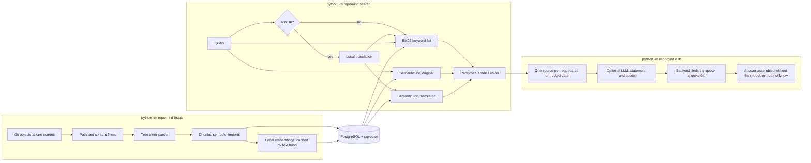

# Architecture

RepoMind is so far a retrieval and answering engine with a command line interface. There is deliberately no web application, user management, GitHub API integration or job queue yet: those come only after the core is shown to find the right code and explain it correctly.

## Reading source code

`repomind/ingest/git_source.py` reads only from Git's object database (`rev-parse`, `ls-tree`, `cat-file`). This one decision settles several requirements:

| Requirement | How reading Git objects meets it |
| --- | --- |
| Citations must match a commit | Content is, by definition, the content of that SHA |
| Do not modify analyzed projects | Plumbing commands run with `GIT_OPTIONAL_LOCKS=0`; a test compares `.git` file timestamps before and after |
| Never run analyzed code | Only `cat-file` output reaches the parser; hooks and filters are not involved, and `core.fsmonitor` is forced off |
| Keep uncommitted secrets out | `.env` files in the working tree are unreachable, and uncommitted edits are ignored |
| No copies of other projects | No snapshot folder is needed |

A `.env` that *was* committed is still reachable through Git, so the filters below apply as well.

## Filtering

`repomind/ingest/filters.py` runs path rules before any content is read:

- any path segment starting with `.` (`.env`, `.git`, `.github`, hidden files);
- dependency and build folders: `node_modules`, `target`, `dist`, `build`, `vendor`, `out`, `coverage` and similar;
- files whose name starts with the word `secret`, `secrets`, `credential`, `credentials` or `creds` (so `secrets.ts`, but not `SecretRotationService.java`), or that carry an `.env.` segment (`prod.env.js`);
- generated files (`*.d.ts`, `*.min.js`, bundles), files over 1 MB, and unsupported languages.

Content rules then reject binary files, non-UTF-8 files, minified code, and files matching high-confidence credential patterns (private keys and AWS, GitHub, OpenAI, Anthropic, Google and Slack tokens). The report names such a file but never its secret. This scan does not catch generic values such as `password = "..."` in code; see [limitations](#known-limitations).

Two more file types need rules of their own:

- **YAML** files with a personal or secret marker in the name (`application-local.yml`, `*-override.yml`, `vault.yml`, `kubeconfig.yml`) and lock files are skipped. In the rest, a chunk holding a literal credential, such as a password key or a URL with a password, is withheld on its own and reported, so that one development password does not hide a whole compose file.
- **SQL** files with a literal `PASSWORD '...'` or `IDENTIFIED BY '...'` are rejected.

## Parsing and chunking

`repomind/parsing/chunker.py` uses Tree-sitter grammars for Java, TypeScript, TSX and JavaScript. Source is parsed, never evaluated.

`repomind/parsing/structured.py` handles the other two. SQL is split into statements by a small lexer that understands comments, strings and dollar quoting. YAML goes through Tree-sitter, which yields syntax nodes only, so a tag such as `!!python/object` stays plain text, unlike with a loader that constructs objects. Neither is ever executed.

| Situation | Result |
| --- | --- |
| Class of up to 40 lines | One chunk |
| Larger class | A header chunk (doc comment, annotations, leading fields) plus member chunks |
| Adjacent members of up to 3 lines, such as getters | One grouped chunk |
| Comment or decorator directly above a declaration | Stays with the declaration |
| Callable over 60 lines or 1500 characters | Split at statement boundaries; a statement that does not fit is split inside its block; raw lines are the last resort |
| Non-declaration top-level code | Merged into `module` chunks |
| `import` statements | Stored as structured rows, not retrievable chunks: they carry no behaviour, yet would rank highly for any query naming a library |

**Line references are exact by construction.** A chunk's `content` is always the lines `start_line..end_line` joined by `\n`, and `\n` is the only line separator. `str.splitlines` is deliberately not used: it also breaks on form feeds and U+2028, which would silently shift every later line number away from what Tree-sitter and Git report.

The parts of a split function stay contiguous and cover it completely. Later parts do not contain the signature, so it is added to the embedded text.

## Storage

PostgreSQL 17 with pgvector runs in RepoMind's own Compose project, on `127.0.0.1:55432`. The schema is in `repomind/store/schema.sql`:

- `repositories`, `snapshots` (one per indexed commit), `files`, `chunks`, `symbols`, `imports`. A new commit replaces the previous snapshot in a single transaction, so a failure cannot leave a half-written index.
- `embeddings`, keyed by `(text_hash, model)` and independent of snapshots. Unchanged code is never embedded twice, across commits and repositories, and interrupted runs resume because each batch commits on its own.
- `llm_usage`, used to enforce the total budget.

Re-indexing the same commit with the same `PIPELINE_VERSION` does nothing.

Semantic search is an exact cosine scan. At about 1,200 chunks it is fast enough, and it keeps an approximate index from capping the measured recall.

## Retrieval

**Keyword** (`search/keyword.py`). BM25 (k1 = 1.2, b = 0.75) over a code-aware tokenizer. `cancelReservation` yields `cancel`, `reserv` and the whole identifier, so both natural language and exact symbol searches match. Symbol names count three times and the file name 1.5 times. The index is built in memory per process, which is simple and fast at this size but will not scale to very large corpora.

**Semantic** (`search/engine.py`, `store/database.py`). Cosine similarity over `intfloat/multilingual-e5-small`: 384 dimensions, MIT licensed, run locally through ONNX with no API cost. Each chunk is embedded with its path and symbol as context. It was chosen on the dev split against `BAAI/bge-small-en-v1.5` and `jinaai/jina-embeddings-v2-base-code`: it was best for Turkish questions and on combined MRR, and it is the only candidate that understands Turkish without the translator. English-only results favoured `bge-small`, though with 11 dev questions the confidence intervals overlap. See [evaluation.md](evaluation.md#embedding-model-comparison).

**Hybrid** (`search/hybrid.py`). Reciprocal Rank Fusion with k = 60: `score(d) = Σ 1 / (60 + rank_list(d))`. It uses only ranks, so BM25 scores and cosine similarities never have to be made comparable, and `--explain` can show exactly why a result is where it is.

**Test code is left out by default.** In the first measurement 55% of the top results for English questions were tests, because tests repeat the vocabulary of the code they exercise. They are included when a query mentions tests or when `--include-tests` is passed.

**Turkish queries** (`search/translation.py`). Code is in English, so a Turkish question shares few terms with it. A pinned local Opus-MT model (CTranslate2, CPU, about 0.1 s) adds an English version of the query. The translation is sometimes wrong, so it is added to the original rather than replacing it. If the model cannot load, search continues with a warning.

These ideas were tested and rejected, and their code removed:

- A per-file result cap made no measurable difference.
- Mapping unknown Turkish words to the nearest code vocabulary through embeddings produced useful pairs such as `Rezervasyon → reservation`, but also noise such as `Şifreler → reconciler`. Similarities sat in a narrow 0.83 to 0.91 band, so no threshold could separate the two.
- Cross-encoder reranking gave no clear gain across both question sets and took about 21 seconds per query with the only candidate worth considering. See [evaluation.md](evaluation.md#reranker).
- Symbol names, file paths, callers and callees as an extra ranked list made results worse or no better on the first question set, so they were never run on the second.

## Answering

`repomind/qa/` answers only through this sequence:

1. Translate a Turkish question to English with the same model. This wording is better than the local translator's, at about 2.5 seconds, so only `ask` uses it. `search` keeps working without any LLM.
2. Retrieve up to 8 chunks with hybrid search.
3. Refuse if the question is about something the code never mentions.
4. Without a configured LLM, stop and return the sources, labelled as not being an AI answer.
5. Send each source to the model in its own request, and enforce the budget before each one.
6. Verify each reply and assemble what survives.

### One source at a time

Asked about 8 sources at once, the small model stitched them into plausible stories: every source was real, none supported the claim. The difference between a source existing and an answer being supported by it is the main problem of this layer.

Each request now holds one source, and the model returns `{"relevant", "statement", "quote"}`: whether this code carries out any step of what is asked, what it does, and the lines that prove it. Reading one source at a time removes the chance to combine them. The cost is about 3 times the input tokens and twice the time per question.

The answer is the verified statements joined together, with no further model call, so it cannot add anything that was not checked. If none survives, the answer is "I do not know" with the closest code. If only one survives, a warning says the answer may be incomplete.

### Refusing without a model

The first run with a real model answered 5 of 6 unanswerable questions by inventing something, such as a `schema.graphql` file that does not exist. Saying "I do not know" therefore cannot be left to a small model.

Retrieval similarity does not help: on the measured questions, unanswerable ones scored as high as answerable ones (cosine 0.82 to 0.87 against 0.80 to 0.89). Vocabulary does differ, so `repomind/qa/sufficiency.py` refuses before any model call when either of these holds:

- a name-like term (`Kafka`, `GraphQL`, `S3`) from the question occurs nowhere in the code;
- at least two ordinary words of an English question occur nowhere in the code.

Words of a translated question only produce a warning. A translation's wording says little about the code, and this rule refused 3 answerable Turkish questions while catching only 2 negatives. Questions refused this way cost nothing. The check cannot catch a question whose every word happens to appear in the code.

### Evidence verification

`repomind/qa/verification.py` checks each reply before it can reach the user:

- The quote has to occur in the source. The search ignores whitespace, allows `...` between exact parts, allows lines given out of order, and accepts a near match only for a single passage at 90% similarity, so that `value_12` can never pass for `value_16`.
- Line numbers come from where the backend found the quote. The model does not supply them. The quote's lines are compared with the blob in Git at the indexed commit, so a tampered database row fails too.
- The text shown is the source's, never the model's copy.
- A quote has to be long enough to prove something (at least 15 characters) and short enough to point at the proof (at most 15 lines).
- A statement is discarded if it names something that is in neither the source nor the question, or drifts into a script that is in neither, such as Chinese in an answer to a Turkish question.

**What this does not prove.** Verification shows that a quote exists at the commit and that the statement names nothing the model cannot have read. It does not show that the statement describes the quote correctly. The `ask` command says so under every answer. This is the largest remaining gap; see [limitations](#known-limitations).

### Prompt injection

Repository content is untrusted: a comment can address the model directly. The defences are layered:

1. Sources are wrapped in tags with a random per-request nonce, so code cannot close the data block.
2. Paths and symbols, which the repository also controls, are reduced to safe characters.
3. The system prompt declares the source to be data.
4. The model has no tools, so an injection can at worst distort the answer text.
5. A source is read alone, so a hostile comment cannot influence what the model says about other sources.
6. Every statement needs a quote that exists in Git, whatever the model was persuaded to say.
7. Repository content and model output have terminal control characters removed before printing.

### Cost and data limits

| Limit | Default |
| --- | --- |
| Chunks read per question | 8 |
| Estimated input tokens per request | 4000 |
| Output tokens per request | 250 |
| Total spend | $0 unless prices and a budget are set |

The budget check runs before each request, using worst-case cost. A non-loopback endpoint is refused unless `REPOMIND_LLM_ALLOW_REMOTE=1`, because it sends source code to a third party, and a remote endpoint with an API key is refused until prices are configured. If an endpoint reports far fewer input tokens than were sent, a warning says that it may have truncated the source.

All providers share one small OpenAI-compatible client using only the standard library. The default local setup is Ollama in a container from RepoMind's Compose file, with no account or API key.

### Memory limits

A run with the 7B model was once stopped because the machine ran critically low on memory, and everything it had answered was lost. Four things now guard against that:

| Measure | Why |
| --- | --- |
| `OLLAMA_MAX_LOADED_MODELS=1` | Two models loaded together were measured at 8.7 GiB |
| `OLLAMA_NUM_PARALLEL=1` | Ollama's default reserved twice the context (`--parallel 2 --ctx-size 16384`), although RepoMind sends one request at a time |
| `OLLAMA_KEEP_ALIVE=2m` and `mem_limit: 8g` | A model is released soon after use, and a model that does not fit fails inside its container |
| `evaluate-ask` | Saves each question to a checkpoint as it finishes, does not start with less than 3 GB free, and stops between questions if free memory falls below that |

Free memory here means the smaller of free physical memory and free commit space, because Windows can run out of commit space while physical memory is still free. A checkpoint records the model, question set and prompts, and refuses to continue a run if any of them changed. The memory check runs between questions, so it cannot catch a spike during one, which is why [`resource_trial.ps1`](../eval/tools/resource_trial.ps1) asks for 10 GB before it loads a model.

## Known limitations

- **A verified quote does not make a statement true.** The model can quote real code and describe it wrongly. In the second evaluation, 5 wrong answers had read the right code and made a statement about it. See [evaluation.md](evaluation.md#phase-2-answers).
- **The refusal check is vocabulary based.** It misses questions whose words all appear in the code. Features next to existing code are the hard case: "how are invitation emails sent?" passes because invitations and emails both exist.
- **Answers are joined, not judged as a whole.** Nothing compares the statements with each other or with the question once they have passed, so an off-topic but true statement stays in the answer.
- **Recall@5 is good on the second set and moderate on the first**, 0.67 to 0.83 against 0.50 to 0.58. See [evaluation.md](evaluation.md).
- **Turkish depends on an imperfect translator**, and detection relies on Turkish letters or common function words, so a bare `stok rezervasyon` is not translated.
- **Adding SQL and YAML cost some Turkish ranking on code questions**, because the new chunks compete with code.
- **2.4% of the code chunks exceed the model's 512-token window** (26 of 1,106, longest 623). Their tails are not embedded, although keyword search still covers them.
- **Secret detection is pattern based.** It catches known token formats and literal credential keys, not every hardcoded password.
- **Only the latest indexed commit is kept per repository.**
- **The keyword index is rebuilt in memory per process.**
- **The evaluation has 57 answerable questions on two repositories**, labelled and graded by one reviewer, so intervals are wide and results may not generalize.
