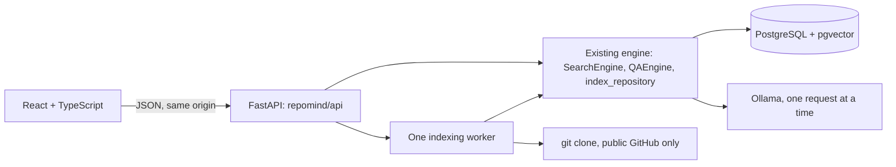

# Product plan

**Status: a plan, and nothing here is built.** It turns the engine into something people can use from a browser.

**What does not change.** Tree-sitter parsing, SQL and YAML chunking, embeddings, pgvector, hybrid search, Git verification, the evidence rule, prompt injection defences, and the evaluation system all stay, and `qwen2.5:7b` stays the default. The API calls the engine and adds no retrieval or answer logic. No model, threshold or prompt tuning belongs to this phase.

**What the product must be honest about.** AI answers are [not reliable](evaluation.md#fifth-question-set): 8 correct sources of 16, 4 wrong, and 6 of 8 unanswerable questions refused. So the product is first a way to find and read code, with AI help that is clearly labelled.

## 1. FastAPI

A thin layer in `repomind/api/`, as an optional `api` dependency (`fastapi`, `uvicorn`). Routes stay synchronous and run in FastAPI's thread pool, because the engine and `Store` are synchronous. Each request gets its own `Store`, and the embedder, translator and LLM client are shared.

| Route | Purpose | Engine |
| --- | --- | --- |
| `POST /api/repositories` | Index a public GitHub URL, returning a job | `index_repository` |
| `GET /api/repositories` | Indexed repositories, with commit and counts | `Store.active_snapshots` |
| `GET /api/jobs/{id}` | Job state, progress and errors | new `index_jobs` table |
| `GET /api/repositories/{id}/tree` | File tree of the indexed commit | `GitRepository.list_files`, `classify_path` |
| `GET /api/repositories/{id}/file?path=` | One file at the indexed commit | `GitRepository.read_file`, `classify_content` |
| `GET /api/search?repo=&q=&mode=&limit=` | Code search, with its reasons | `SearchEngine.search` |
| `POST /api/ask` | A question about one repository | `QAEngine.ask` |
| `GET /api/health` | Database, model and free memory | `available_memory_gb` |

`POST /api/ask` returns `status`, `message`, `translated_query`, `note`, `warnings`, and `sources` from `AskResult.sources()`. Each source carries its path, lines, commit and text, plus `exists_in_git`, `answer_check` and a role: `answer`, `review_candidate` or `closest`. These are separate fields so that no client can confuse them.

**Limits the engine already implies:**

- One generation at a time, matching `OLLAMA_NUM_PARALLEL=1`. A second question waits briefly, then gets `429` with `Retry-After`.
- Below 4 GB free, `ask` and indexing return `503` before starting, using `available_memory_gb`.
- If Ollama is off, `ask` falls back to `no_llm` and says so.
- It binds to `127.0.0.1` by default, and allows only its own origin.
- `KeywordIndex` is cached per snapshot, so entries for a replaced snapshot are dropped when a repository is reindexed.

## 2. React + TypeScript

Vite, React, strict TypeScript, TanStack Query and React Router. Types are generated from FastAPI's OpenAPI document with `openapi-typescript`, so the client cannot drift from the API. FastAPI serves the built files in production, and Vite proxies `/api` in development.

Repository content is untrusted, so code, paths and notes are always rendered as text. `dangerouslySetInnerHTML` is not used on any of it. Syntax highlighting comes after the rest works, and only with a library that produces safe tokens.

## 3. GitHub URL indexing

Only public `https://github.com/<owner>/<repo>` URLs. The steps of a job:

1. **Validate strictly.** One pattern for the URL, with no credentials, ports, query strings or other hosts. `file://`, `ssh://` and `git@` are rejected.
2. **Check it is public** with GitHub's unauthenticated `GET /repos/{owner}/{repo}`, which also gives its size and default branch. Refuse above a size limit. Rate limit replies are reported, and never retried in a loop.
3. **Clone without running anything:** `git clone --no-checkout --depth 1 --single-branch --no-tags`, with `core.hooksPath` empty, `protocol.allow=never`, `protocol.https.allow=always`, `GIT_TERMINAL_PROMPT=0`, no submodules, no LFS, a timeout and a disk limit. `--no-checkout` is used and not `--bare`, because `GitRepository` requires a work tree to exist, and it writes none of the repository's files.
4. **Index the commit** with the existing `index_repository`, which reads only Git objects, skips what the filters exclude, and withholds credentials. Progress goes to the job.
5. **Clean up on failure,** and show what was skipped from `IndexReport.skipped`.

Jobs run one at a time in a single worker, and their state lives in a new `index_jobs` table. A restart marks running jobs as failed. Repositories are named `owner/repo`, so that two owners cannot collide. Clones live in a gitignored data folder.

Languages other than Java, TypeScript, JavaScript, SQL and YAML are not parsed, and the UI says so for each repository.

## 4. Screens

- **Repositories.** A URL field, the indexed repositories with commit and date, job progress, and reindex and remove actions.
- **Repository workspace.** A file tree on the left, and a code view with line numbers and links such as `#L57-L60`, always at the indexed commit, which is shown.
- **Code search.** A query box, keyword, semantic or hybrid, results with path, lines and preview, and an optional "why this result". A result opens at its lines in the code view.
- **Ask.** A question box and one of the answer states below. Each source opens at its lines in the code view.

Search and the code view need no model, so they work with Ollama off.

## 5. Answers that may be wrong

The UI never says "answer" without a qualifier, and it shows the two checks as two separate labels:

| Engine state | What the reader sees |
| --- | --- |
| `answered` | "The model chose these lines." Each carries "exists at this commit" and "passed the evidence rule, which does not prove it answers". |
| `answered`, with a turned-down choice | As above, and the turned-down lines in a separate section |
| `insufficient`, with a `review_candidate` | "I do not know", then "Source to review", with path, lines and code, and "nothing confirms that this answers the question" |
| `insufficient` | "I do not know", then the closest lines, marked as not an answer |
| `no_llm` | "This is not an AI answer: no model was used", then the closest lines |
| `invalid_response` | "I do not know: the model did not reply validly" |

- **The model's note stays collapsed by default,** under "the model's reading, not verified", because notes have claimed features that do not exist.
- **A source to review can never look like an answer.** It has its own section and a neutral style, and it never changes the status.
- **A short, permanent line in the Ask screen** says that AI answers are not reliable, and links to the measured results.
- **The same wording applies to Turkish questions,** with "İncelenebilecek kaynak adayı" as already used by the CLI.

## 6. Tests

**Security.** These matter more now, because anyone can point it at repository content they control.

- URL validation: other hosts, credentials, ports, `file://`, path tricks and redirects.
- The tree and file routes: path traversal, and that excluded files and files holding credentials are never returned.
- Repository code is never executed: hooks in a fixture repository do not run, and no working tree files are written.
- Prompt injection through a fixture repository, reusing the existing defences.
- Script tags in code, paths and notes render as text, in a browser test.
- Request size limits, query length limits, and only-own-origin CORS.
- Errors do not expose local paths or stack traces.

**Performance.** Budgets from what was measured, checked by a small script and not by a benchmark of the model:

| Measure | Budget | Measured so far |
| --- | --- | --- |
| Search and passages, no model, median | 1 s | 0.65 s |
| `ask`, mean, on this machine | 10 s | 6.6 s, at most 13 s |
| Tree and file routes | 200 ms | not measured |
| API process, peak | 1.5 GB | Python 1.05 GB |

Plus a test that a second concurrent `ask` gets `429` and does not start a second generation, and one that indexing and `ask` refuse below the memory limit.

**Integration.**

- API tests with FastAPI's `TestClient`, the existing test database, and the existing fake LLM client, so that they need no model.
- A contract test that `sources` carries both checks, and that a `review_candidate` never appears as an answer.
- Playwright tests through the main paths on a small local fixture repository: index, browse, search, ask, and every answer state above.
- One manual run against a real public repository before calling a milestone finished. It is not part of the automatic tests, so the tests need no network.

## Order of work

1. **Read-only API** over the existing index: tree, file, search, ask, health, with their tests.
2. **GitHub indexing** as jobs, with its security tests.
3. **React shell:** repositories, workspace, code view and search.
4. **Ask screen,** with every state in section 5.
5. **Hardening:** browser security tests, performance budgets, documentation, and a short demo.

Each step ends with passing tests and a local commit. Nothing is pushed without being asked.

## Out of scope for now

Accounts and multiple users, private repositories, public hosting, more languages, keeping several commits per repository, paid APIs, new models, and further evaluation sets.

## Decisions for the owner

1. **Single user on one machine,** which this plan assumes? Hosting for others would need accounts, quotas and sandboxing, and a different plan.
2. **Interface language:** Turkish, English, or both from the start?
