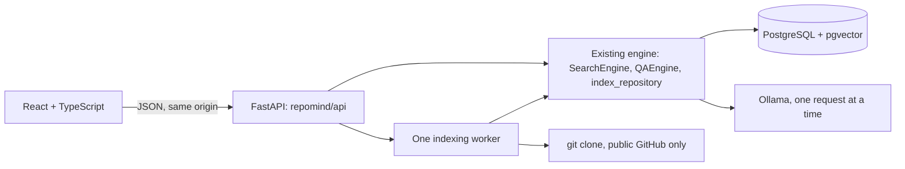

# Product plan

**Status: built.** This was the plan for turning the engine into something people can use from a browser. It now records what was built, and where that differs from the plan. For how it works, see [the architecture](architecture.md#web-application), and to run it, see the [README](../README.en.md#getting-started-on-windows).

**What did not change.** Tree-sitter parsing, SQL and YAML chunking, embeddings, pgvector, hybrid search, Git verification, the evidence rule, prompt injection defences, and the evaluation system all stay, and `qwen2.5:7b` stays the default. The API calls the engine and adds no retrieval or answer logic. No model, threshold or prompt was tuned in this phase, and no evaluation result changed.

**What the product is honest about.** AI answers are [not reliable](evaluation.md#fifth-question-set): 8 correct sources of 16, 4 wrong, and 6 of 8 unanswerable questions refused. So the product is first a way to find and read code, with AI help labelled **Experimental AI Analysis**.

## Decisions made

| Question | Decision |
| --- | --- |
| Who is it for? | One person on one machine, listening only on `127.0.0.1` |
| Interface language | English |
| Question language | Turkish and English |
| Background work | One thread and a table, with no separate service |

## The API

| Route | Purpose | Engine |
| --- | --- | --- |
| `GET /api/health` | Database, model state and free memory | `available_memory_gb` |
| `GET /api/repositories` | Indexed repositories, with commit and counts | `Store.active_snapshots` |
| `POST /api/repositories` | Add a public GitHub URL, returning a job | `index_repository` |
| `DELETE /api/repositories?repo=` | Remove a repository added by URL | |
| `GET /api/jobs`, `GET /api/jobs/{id}` | Job state, progress and errors | `index_jobs` table |
| `POST /api/jobs/{id}/retry` | Retry a failed job | |
| `DELETE /api/jobs/{id}` | Clear a finished job from the list | |
| `GET /api/tree?repo=` | Indexed files of the indexed commit | `Store.indexed_files` |
| `GET /api/file?repo=&path=&commit=` | One indexed file at that commit | `Store.indexed_file`, `GitRepository` |
| `GET /api/search?repo=&q=&mode=&limit=&include_tests=` | Code search, with its reasons | `SearchEngine.search` |
| `POST /api/ask` | A question about one repository | `QAEngine.ask` |

Routes use query parameters and not `/api/repositories/{id}/...` as first planned, because a repository name such as `owner/name` holds a slash.

## Differences from the plan

- **An `api` extra was not needed.** `fastapi` and `uvicorn` are ordinary dependencies, because the application is now the main way to use RepoMind.
- **Port 7321, not 8765.** Windows reserves ranges that include 8765, so binding there fails.
- **A second question returns `429` at once,** and does not wait briefly first. The page disables sending while a question runs, so this is only reached by another tab.
- **Low memory does not return `503`.** A question still returns the closest lines and says why the model was not asked, and an indexing job fails with a readable message.
- **Turkish questions see the English interface,** so a source to review is labelled "Source to review". The command line keeps its own wording.
- **Reindex is adding the same address again.** There is no separate button.
- **Added:** clearing a finished job, and showing only the newest job per repository.

## Answers that may be wrong

The page never says "answer" without a qualifier, and it shows the two checks as two separate labels.

| API `verdict` | What the reader sees |
| --- | --- |
| `lines_chosen` | "The model chose these lines." Each carries "In Git at" and "Passed the evidence rule, not proof of an answer" |
| `not_enough_evidence` | "I do not know", then the closest lines, collapsed and marked as not an answer |
| `not_enough_evidence`, with a `review_candidate` | "I do not know", then "Source to review", with path, lines, code and "Answer not verified" |
| `invalid_response` | "No valid answer", then the closest lines |
| `ai_unavailable` | "AI unavailable", why, and the closest lines, open |

- **The model's reading stays collapsed by default,** marked "unverified, may be false", because such notes have claimed features that do not exist.
- **A source to review can never look like an answer.** It has its own section and never changes the verdict.
- **A short, permanent line in the panel** gives the measured result.

## Tests

| Layer | What it covers |
| --- | --- |
| `tests/test_api.py` | Browsing, search, every answer state, path traversal, secrets, and local server safety |
| `tests/test_github_indexing.py` | Hostile addresses, what a clone may do, limits, retries, restarts, and removal |
| `tests/test_api_contract.py` | The client's generated types match the API |
| `web/src/lib/*.test.ts` | Links, the file tree, and highlighting |
| `web/e2e/app.spec.ts` | A real browser through every main path, with fake models and a fake GitHub |

Two real public repositories, `expressjs/cors` and `spring-projects/spring-petclinic`, were also added by hand, and a few questions were asked through the page with the real model, with and without the GPU. Those are not part of the automatic tests, so the tests need no network, and those questions are not a measurement.

## Performance

Measured once on the development machine, with the two indexed repositories. This is not a benchmark.

| Measure | Budget | Measured |
| --- | --- | --- |
| Search, no model, median once loaded | 1 s | 0.05 s. The first search takes about 3 s, loading the models |
| `ask`, mean, on this machine | 10 s | 6.6 s, at most 13 s, in the final evaluation |
| Tree route, median | 200 ms | 45 ms |
| File route, median | 200 ms | 94 ms |
| API process, peak | 1.5 GB | 1.04 GB reading and searching. **1.85 GB while indexing 426 chunks, which is over budget.** The model is outside it |
| Adding by URL, 426 chunks, on the CPU | | 27 s |

## Out of scope for now

Accounts and multiple users, private repositories, public hosting, more languages, keeping several commits per repository, paid APIs, new models, and further evaluation sets.
